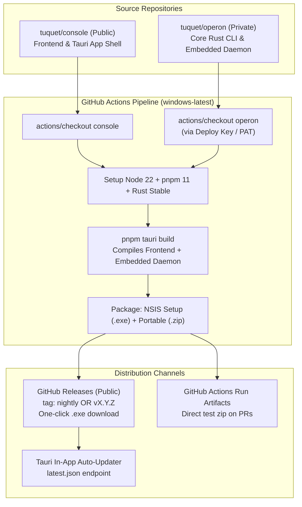

# Spec: Automated Release & Distribution Pipeline for Operon Workstation

## 1. Executive Summary & Brainstorm Analysis

### 1.1 The Problem
To test new features or bug fixes in Operon Workstation today, a user must:
1. Clone multiple repositories (`tuquet/console` and `tuquet/operon`).
2. Install Node.js v22, pnpm v11, and the Rust toolchain (Cargo, MSVC Build Tools).
3. Configure environment variables (`.env`).
4. Run `pnpm install`, build packages, and launch via `pnpm tauri dev` or `cargo build`.

**Target Audience Need:** Non-technical testers, product managers, QA engineers, and external users cannot run this developer loop. They need a single, pre-built binary (`.exe` or installer) that they can download with one click, run immediately, and test with zero configuration.

---

### 1.2 Brainstorm: Architecture & Strategy Comparison



#### Comparison of Distribution Strategies

| Dimension | Option A: Actions Artifacts (PRs/Commits) | Option B: Rolling Nightly / Pre-Release | Option C: Semantic Tagged Releases (`v*`) | Option D: Hybrid Pipeline (Recommended) |
|---|---|---|---|---|
| **Trigger** | Every commit / PR | Push to `main` branch | Push git tag `v*` or Manual Dispatch | **Actions Artifacts on PRs + Nightly on `main` + Formal Tagged Releases** |
| **Download Access** | Requires GitHub login | **Direct Public Link (No login required)** | **Direct Public Link (No login required)** | **Both (Quick PR tests + Public stable links)** |
| **Retention** | 7 to 14 days (auto-deleted) | Rolling (always points to latest) | Permanent version history | Permanent for tags, rolling for nightly, ephemeral for PRs |
| **Tauri Updater Support** | No | Optional | **Yes (`latest.json`)** | **Yes for Releases, standalone for Nightly** |
| **Ideal Use Case** | Developer testing specific PR | Rapid daily testing for QA team | Production / Client distribution | **Full lifecycle coverage** |

---

### 1.3 Key Architectural Discovery: Multi-Repo Dependency

In `apps/workstation/src-tauri/Cargo.toml`, line 28 declares:
```toml
operon = { package = "operon", path = "../../../../operon/crates/cli" }
```
- **Local Layout:** `Repository/console` and `Repository/operon` are sibling directories.
- **Repository Visibility:**
  - `tuquet/console`: **PUBLIC**
  - `tuquet/operon`: **PRIVATE**
- **Solution for CI:**
  The CI workflow in `tuquet/console` checks out both repositories into side-by-side folders:
  - `${{ github.workspace }}/console`
  - `${{ github.workspace }}/operon`
  
  Relative path `../../../../operon/crates/cli` from `console/apps/workstation/src-tauri` resolves **identically** to local developer machines without altering a single line of Rust code!
  Access to private `tuquet/operon` is authenticated via a repository secret:
  - Preferred: GitHub Deploy Key (read-only SSH key dedicated to `tuquet/operon`)
  - Alternative: Fine-grained Personal Access Token (`OPERON_READ_TOKEN`) with `Contents: Read` on `tuquet/operon`.

---

## 2. Objective & Scope

### 2.1 Core Objective
Automate the build, packaging, and distribution of **Operon Workstation** for Windows (`x86_64`) so that anyone can download and run the application without installing any developer tools.

### 2.2 User Stories
1. **As a QA Tester**, I want to download the latest test build (`Operon-Workstation-Setup.exe` or portable `.zip`) directly from a public URL so I can test new features on clean Windows without installing Node or Rust.
2. **As an End User / Stakeholder**, when I run the downloaded executable, the application must automatically start the embedded background daemon and migrate local SQLite database tables seamlessly.
3. **As a Developer**, when I merge a feature to `main` or trigger a release tag, GitHub Actions should automatically build and publish the release without manual intervention.

---

## 3. Tech Stack & Tools

- **Desktop Framework:** Tauri v2 (`@tauri-apps/cli` v2, `tauri` v2)
- **Frontend:** Vue 3, Vite, Tailwind CSS, Pinia, Drizzle ORM, LibSQL
- **Backend / Daemon:** Rust (embedded in-process daemon via `operon::commands::worker::supervisor::run_server`)
- **CI / CD Runner:** GitHub Actions (`windows-latest`)
- **Packaging Targets:**
  1. `nsis`: Windows Setup Installer (`.exe`), currentUser mode (no admin privilege prompt).
  2. Standalone Portable Zip (`.zip` containing `Operon Workstation.exe` and webview runtime dependencies).
- **Auto-Updater:** `@tauri-apps/plugin-updater` with GitHub Releases metadata (`latest.json`).

---

## 4. Commands

### 4.1 Local Verification & Packaging Commands
```bash
# 1. Typecheck and lint frontend
pnpm --filter @operon/workstation typecheck

# 2. Build local frontend bundle
pnpm --filter @operon/workstation build

# 3. Build standalone unbundled executable (rapid local test)
pnpm --filter @operon/workstation tauri:build:exe

# 4. Build official NSIS installer (production packaging)
pnpm --filter @operon/workstation tauri:build
```

### 4.2 CI Release Trigger Commands
```bash
# Trigger a rolling test release manually via GitHub CLI
gh workflow run release.yml -R tuquet/console -f channel=nightly

# Trigger an official semantic release tag (via Gateway Proxy)
git tag v5.8.0
git spush origin v5.8.0

# Download latest test release installer directly via CLI
gh release download nightly -R tuquet/console --pattern "*Setup.exe"
```

### 4.3 Direct Download Links for Testers (Browser URL)
- **Latest Nightly Installer:**
  `https://github.com/tuquet/console/releases/download/nightly/Operon-Workstation-Setup.exe`
- **Latest Portable Zip:**
  `https://github.com/tuquet/console/releases/download/nightly/Operon-Workstation-Portable.zip`
- **All Releases Dashboard:**
  `https://github.com/tuquet/console/releases`

---

## 5. Project Structure & File Locations

```
console/
├── .github/
│   ├── actions/
│   │   └── setup-node/action.yml
│   └── workflows/
│       ├── ci.yml                 # PR checks (typecheck, lint, unit tests)
│       └── release.yml            # Automated build & release pipeline
├── apps/
│   └── workstation/
│       ├── src-tauri/
│       │   ├── Cargo.toml         # References ../../../../operon/crates/cli
│       │   ├── tauri.conf.json    # Bundle config & updater endpoint
│       │   └── src/
│       │       └── lib.rs         # Embedded daemon auto-spawn
│       ├── package.json
│       └── vite.config.ts
└── scripts/
    └── package-portable.mjs       # Helper to zip standalone .exe for testers
```

---

## 6. Code Style & CI Workflow Specification

### 6.1 GitHub Actions Workflow Blueprint (`.github/workflows/release.yml`)

The workflow must implement:
1. **Parallel / Dual Checkout:**
   Check out `tuquet/console` into `./console` and `tuquet/operon` into `./operon`.
2. **Smart Caching:**
   Cache `~/.cargo/bin`, `~/.cargo/registry`, `~/.cargo/git`, and Rust `target/` using `Swatinem/rust-cache@v2`.
   Cache `~/.pnpm-store` via `actions/setup-node`.
3. **Packaging Step:**
   Execute `pnpm --filter @operon/workstation tauri:build`.
4. **Publishing Step:**
   Upload assets to GitHub Releases using `softprops/action-gh-release@v2`.

```yaml
name: Release Operon Workstation

on:
  push:
    tags:
      - 'v*'
  workflow_dispatch:
    inputs:
      channel:
        description: 'Release Channel (nightly | preview | stable)'
        required: true
        default: 'nightly'
        type: choice
        options:
          - nightly
          - preview
          - stable

permissions:
  contents: write

jobs:
  build-windows:
    name: Build Windows x64 Installer
    runs-on: windows-latest
    steps:
      - name: Checkout Console Repository
        uses: actions/checkout@v4
        with:
          path: console

      - name: Checkout Operon Subsystem (Private)
        uses: actions/checkout@v4
        with:
          repository: tuquet/operon
          token: ${{ secrets.OPERON_ACCESS_TOKEN }}
          path: operon

      - name: Setup Rust Toolchain
        uses: dtolnay/rust-toolchain@stable
        with:
          targets: x86_64-pc-windows-msvc

      - name: Rust Cache
        uses: Swatinem/rust-cache@v2
        with:
          workspaces: |
            console/apps/workstation/src-tauri -> target
            operon -> target

      - name: Setup Node.js 22
        uses: actions/setup-node@v4
        with:
          node-version: 22

      - name: Setup pnpm 11
        uses: pnpm/action-setup@v4
        with:
          version: 11

      - name: Install Frontend Dependencies
        working-directory: console
        run: pnpm install --frozen-lockfile

      - name: Build Tauri Desktop Bundle
        working-directory: console/apps/workstation
        env:
          VITE_SUPABASE_URL: ${{ secrets.VITE_SUPABASE_URL }}
          VITE_SUPABASE_ANON_KEY: ${{ secrets.VITE_SUPABASE_ANON_KEY }}
        run: pnpm tauri:build

      - name: Publish to GitHub Releases
        uses: softprops/action-gh-release@v2
        if: startsWith(github.ref, 'refs/tags/v')
        with:
          files: |
            console/apps/workstation/src-tauri/target/release/bundle/nsis/*.exe
            console/apps/workstation/src-tauri/target/release/bundle/msi/*.msi
          draft: false
          prerelease: false
          generate_release_notes: true
```

---

## 7. Testing & Verification Strategy

### 7.1 Automated CI Verification Gate
Before releasing any package, the CI pipeline runs:
- `pnpm --filter @operon/workstation typecheck`
- `pnpm vitest run apps/workstation/src/db/__tests__` (all 19 SQLite and Cloud Sync unit tests must pass)
- Binary sanity check: verify output installer `.exe` exists and exceeds minimum expected payload size (> 15 MB).

### 7.2 Non-Dev Tester Acceptance Protocol (Manual Verification)
When a tester downloads `Operon-Workstation-Setup.exe` on a clean Windows machine without developer tools:
1. **Installation:** Double-click `.exe`. Installer runs in currentUser mode without requiring Administrator UAC elevation.
2. **First Launch:** App opens to Loading screen $\rightarrow$ main dashboard within 3 seconds.
3. **Daemon Auto-Spawn:** In Task Manager or Resource Monitor, `Operon Workstation.exe` runs with internal port `8765` listening.
4. **SQLite Auto-Migration:** `%USERPROFILE%\.operon\data\operon.sqlite` is automatically initialized with 12 tables and indices.
5. **No Local Dev Prerequisites:** No Node, Rust, or Git required on the target machine.

---

## 8. Boundaries

### Always Do:
- Build Windows installers using `installMode: currentUser` in NSIS config so testers do not require Admin privileges.
- Enforce strict branch/tag protection so only verified code on `main` or official `v*` tags produces public releases.
- Cache Cargo and pnpm dependencies in CI to prevent 30-minute build delays.
- Sanitize all environment secrets (`VITE_SUPABASE_URL`, `OPERON_ACCESS_TOKEN`) using GitHub Actions Secrets.

### Ask First:
- Changing release versioning scheme (e.g. Semantic Versioning vs Date-based Nightly).
- Setting up Minisign Code Signing keys for the Tauri Auto-Updater.
- Enabling automatic macOS / Linux runner matrix (incurs higher GitHub Actions billable minutes).

### Never Do:
- Never commit private tokens, SSH keys, or Supabase service keys into git history or public release assets.
- Never publish an unverified or failing build to the `stable` release channel.
- Never require end testers to install Node.js, Python, or Cargo to run the application.

---

## 9. Success Criteria (Acceptance Gate)

1. [ ] **Automated CI Workflow:** Pushing a tag `v*` or triggering `workflow_dispatch` in `tuquet/console` successfully completes on GitHub Actions `windows-latest`.
2. [ ] **Multi-Repo Checkout:** CI clones both `tuquet/console` and private `tuquet/operon` side-by-side without path errors.
3. [ ] **Artifact Generation:** CI produces a signed or packaged `.exe` installer under `tuquet/console/releases`.
4. [ ] **One-Click Download:** Testers can download the `.exe` directly from a public URL without GitHub credentials.
5. [ ] **Zero-Dev Launch:** The downloaded `.exe` runs on a clean Windows 10/11 machine, starts the embedded daemon, migrates SQLite, and displays the UI with 0 errors.

---

## 10. Open Questions for Decision

1. **Private Subsystem Access (`tuquet/operon`):**
   Should we generate a dedicated read-only **Deploy Key** on `tuquet/operon` and store its private SSH key in `tuquet/console` secrets as `OPERON_DEPLOY_KEY`, or use a **GitHub Fine-Grained Personal Access Token (PAT)**? *(Recommended: Deploy Key - scoped strictly to this one repo, cannot expire unexpectedly).*

2. **Release Channels Strategy:**
   Do you prefer:
   - **Option 1 (Nightly Rolling + Version Tags):** Every push to `main` updates a rolling `nightly` release tag for instant daily QA, while git tags (`v5.8.1`) create permanent customer releases?
   - **Option 2 (Manual / Tag-Only):** Releases are only generated when manually triggered or when a version tag (`v*`) is pushed?

3. **Auto-Updater (`latest.json`) Activation:**
   Currently `tauri.conf.json` has updater configured with pubkey pointing to `https://github.com/operon/console/releases/latest/download/latest.json`.
   Should we update this URL to `https://github.com/tuquet/console/releases/latest/download/latest.json` now, and do you want Tauri In-App Auto-Update active for testers right away, or distribute standalone installers first?
