# Tài Liệu Đặc Tả Hệ Thống Định Tuyến (Admin Routing Reference)

> **Mã tài liệu:** `ARCH-ADMIN-ROUTES`  
> **Áp dụng cho:** `tuquet/admin` (`apps/web-admin`)  
> **Tài liệu kiến trúc tổng thể:** [`docs/architecture/overview.md`](../architecture/overview.md)  
> **Quyết định liên quan:** [`ADR-001: Định Tuyến & Đa Schema`](../decisions/0001-routing-architecture.md) | [`ADR-003: Platform Superadmin`](../decisions/0003-platform-superadmin.md)

---

## 1. Tổng Quan Kiến Trúc (Architecture Overview)

Hệ thống định tuyến của `admin.tuquet.com` được phân rã thành **5 module chuyên biệt** tại thư mục `apps/web-admin/src/router/routes/modules/`, kết hợp cùng cụm tuyến xác thực lõi `core.ts`.

Mỗi cụm route được cô lập theo ranh giới Plugin (`plugin boundary`) từ `public.system_plugins`. Giao diện chỉ hiển thị và kích hoạt tuyến đường khi plugin tương ứng mang trạng thái `installed`.

```mermaid
graph TD
    AppRoot["/ (Root Router)"] --> AuthModule["/auth (AuthPageLayout)"]
    AppRoot --> CoreModule["/ (BasicLayout)"]

    AuthModule --> Login["/auth/login"]
    AuthModule --> Register["/auth/register"]
    AuthModule --> Callback["/auth/callback"]
    AuthModule --> Desktop["/auth/desktop"]

    CoreModule --> DashboardMod["/dashboard (core-iam)"]
    CoreModule --> TenantsMod["/tenants (core-iam)"]
    CoreModule --> FleetMod["/fleet (runners)"]
    CoreModule --> AutoMod["/automation (automa)"]
    CoreModule --> SystemMod["/system (core-iam)"]

    DashboardMod --> Analytics["/dashboard/analytics"]

    TenantsMod --> TenantsList["/tenants (List)"]
    TenantsMod --> TenantDetail["/tenants/:id (?tab=)"]

    FleetMod --> Devices["/fleet/devices"]
    FleetMod --> Browsers["/fleet/browsers"]
    FleetMod --> Proxies["/fleet/proxies"]

    AutoMod --> Workflows["/automation/workflows"]
    AutoMod --> Runs["/automation/runs"]
    AutoMod --> RunDetail["/automation/runs/:id"]

    SystemMod --> SysPlugins["/system/plugins"]
    SystemMod --> SysPlans["/system/plans (subscriptions)"]
    SystemMod --> SysUsers["/system/users (superadmin)"]
    SystemMod --> SysAudit["/system/audit-logs (superadmin)"]
    SystemMod --> SysSubs["/system/subscriptions (superadmin)"]
    SystemMod --> SysRoles["/system/roles (superadmin)"]
```

---

## 2. Bảng Danh Mục Tuyến Đường Toàn Diện (22 Routes Master Inventory)

| Tuyến Đường (Path) | Tên Tuyến (Name) | Plugin Quản Lý | Quyền Truy Cập (`meta.authority`) | Layout | File Giao Diện (Component) | Schema & Bảng Dữ Liệu |
| :-- | :-- | :-- | :-- | :-- | :-- | :-- |
| **`/dashboard/analytics`** | `Analytics` | `core-iam` | Authenticated | `BasicLayout` | [`analytics/index.vue`](../../apps/web-admin/src/views/dashboard/analytics/index.vue) | `public.tenants`, `public.system_plugins` |
| **`/tenants`** | `Tenants` | `core-iam` | `['superadmin', 'tenants:read']` | `BasicLayout` | [`tenants/index.vue`](../../apps/web-admin/src/views/tenants/index.vue) | `public.tenants` |
| **`/tenants/:id`** | `TenantDetail` | `core-iam` | `['superadmin', 'tenants:read']` | `BasicLayout` | [`tenants/detail.vue`](../../apps/web-admin/src/views/tenants/detail.vue) | `public.tenants`, `tenant_members`, `billing.subscriptions`, `audit_logs` |
| **`/fleet/devices`** | `FleetDevices` | `runners` | `['superadmin', 'runners:devices:read']` | `BasicLayout` | [`devices/index.vue`](../../apps/web-admin/src/views/fleet/devices/index.vue) | `runners.devices` |
| **`/fleet/browsers`** | `FleetBrowsers` | `runners` | `['superadmin', 'runners:browsers:read']` | `BasicLayout` | [`browsers/index.vue`](../../apps/web-admin/src/views/fleet/browsers/index.vue) | `runners.browsers` |
| **`/fleet/proxies`** | `FleetProxies` | `runners` | `['superadmin', 'runners:proxies:read']` | `BasicLayout` | [`proxies/index.vue`](../../apps/web-admin/src/views/fleet/proxies/index.vue) | `runners.proxies` |
| **`/automation/workflows`** | `AutomationWorkflows` | `automa` | `['superadmin', 'automa:workflows:read']` | `BasicLayout` | [`workflows/index.vue`](../../apps/web-admin/src/views/automation/workflows/index.vue) | `automa.workflows` |
| **`/automation/runs`** | `AutomationRuns` | `automa` | `['superadmin', 'automa:campaigns:read']` | `BasicLayout` | [`runs/index.vue`](../../apps/web-admin/src/views/automation/runs/index.vue) | `automa.campaign_runs` |
| **`/automation/runs/:id`** | `AutomationRunDetail` | `automa` | `['superadmin', 'automa:logs:read']` | `BasicLayout` | [`runs/detail.vue`](../../apps/web-admin/src/views/automation/runs/detail.vue) | `automa.campaign_runs`, `automa.execution_logs` |
| **`/system/plugins`** | `SystemPlugins` | `core-iam` | `['superadmin', 'plugins:read']` | `BasicLayout` | [`plugins/index.vue`](../../apps/web-admin/src/views/system/plugins/index.vue) | `public.system_plugins` |
| **`/system/plans`** | `SystemPlans` | `subscriptions` | `['superadmin', 'subscriptions:read']` | `BasicLayout` | [`plans/index.vue`](../../apps/web-admin/src/views/system/plans/index.vue) | `billing.plans` |
| **`/system/users`** | `SystemUsers` | `core-iam` | `['superadmin']` | `BasicLayout` | [`users/index.vue`](../../apps/web-admin/src/views/system/users/index.vue) | `public.profiles` |
| **`/system/audit-logs`** | `SystemAuditLogs` | `core-iam` | `['superadmin']` | `BasicLayout` | [`audit-logs/index.vue`](../../apps/web-admin/src/views/system/audit-logs/index.vue) | `public.audit_logs` |
| **`/system/subscriptions`** | `SystemSubscriptions` | `subscriptions` | `['superadmin']` | `BasicLayout` | [`subscriptions/index.vue`](../../apps/web-admin/src/views/system/subscriptions/index.vue) | `billing.subscriptions` |
| **`/system/roles`** | `SystemRoles` | `core-iam` | `['superadmin']` | `BasicLayout` | [`roles/index.vue`](../../apps/web-admin/src/views/system/roles/index.vue) | `public.roles`, `permissions` |
| **`/auth/login`** | `Login` | Core | Public | `AuthPageLayout` | [`login.vue`](../../apps/web-admin/src/views/_core/authentication/login.vue) | Supabase Auth API |
| **`/auth/register`** | `Register` | Core | Public | `AuthPageLayout` | [`register.vue`](../../apps/web-admin/src/views/_core/authentication/register.vue) | Supabase Auth API |
| **`/auth/forget-password`** | `ForgetPassword` | Core | Public | `AuthPageLayout` | [`forget-password.vue`](../../apps/web-admin/src/views/_core/authentication/forget-password.vue) | Supabase Auth API |
| **`/auth/reset-password`** | `ResetPassword` | Core | Public | `AuthPageLayout` | [`reset-password.vue`](../../apps/web-admin/src/views/_core/authentication/reset-password.vue) | Supabase Auth API |
| **`/auth/callback`** | `AuthCallback` | Core | Public | `AuthPageLayout` | [`callback.vue`](../../apps/web-admin/src/views/_core/authentication/callback.vue) | Supabase OAuth Flow |
| **`/auth/desktop`** | `DesktopBridge` | Core | Authenticated | `AuthPageLayout` | [`desktop-bridge.vue`](../../apps/web-admin/src/views/_core/authentication/desktop-bridge.vue) | Desktop Loopback SSO |
| **`/profile`** | `Profile` | Core | Authenticated | `BasicLayout` | [`profile/index.vue`](../../apps/web-admin/src/views/_core/profile/index.vue) | `public.profiles` |

---

## 3. Cơ Chế Lọc Plugin Gate (`plugin-gate.ts`)

Mỗi khi người dùng khởi động phiên làm việc, router chạy hàm lọc thuần khiết `filterRoutesByPlugins(routes, installedPluginIds)`.

### Quy Tắc Xử Lý:

1. **Route không khai báo `meta.plugin`:** Được giữ nguyên (ví dụ route công khai hoặc thuộc layout chung).
2. **Route khai báo `meta.plugin`:** Kiểm tra xem plugin ID có nằm trong danh sách các plugin đã cài đặt (`status === 'installed'` trong `public.system_plugins`) hay không.
3. **Đệ quy trên Route Con (`children`):**
   - Nếu toàn bộ route con bị lọc bỏ, route cha cũng sẽ tự động bị ẩn khỏi menu.
   - Nếu route con có plugin chuyên biệt (như `/system/plans` thuộc `subscriptions`), nó sẽ được đánh giá độc lập so với route cha (`/system` thuộc `core-iam`).

---

## 4. Động Hóa Đánh Giá Quyền Hạn (Dynamic Authority)

Thay vì kiểm tra vai trò cứng (`role: ['admin']`), router áp dụng cơ chế đánh giá động qua [`apps/web-admin/src/api/core/access.ts`](../../apps/web-admin/src/api/core/access.ts):

1. **Superadmin Bypass:** Nếu tài khoản có `platform_role === 'superadmin'` (qua JWT app_metadata hoặc hàm `public.is_platform_admin()`), user sở hữu quyền `superadmin` và toàn quyền truy cập 100% routes.
2. **Tenant Dynamic Permissions:** Với user thông thường, hệ thống truy vấn các vai trò của user qua `public.tenant_members` $\rightarrow$ `public.member_roles` $\rightarrow$ `public.roles` $\rightarrow$ `public.role_permissions`.
3. Khớp chuỗi permission định dạng `<module>:<action>` hoặc `<module>:<resource>:<action>` (ví dụ `runners:devices:read`, `automa:workflows:read`).

---

## 5. Tiêu Chuẩn Giao Diện Bắt Buộc (UI Standards)

Mọi route quản trị đều tuân thủ các quy tắc sau:

- **Mobile-First Dual View:**
  - Desktop (`hidden md:block`): Data Table phẳng, viền `border-border/60`, hỗ trợ sắp xếp và phân trang.
  - Mobile (`block md:hidden`): Danh sách thẻ compact cảm ứng (`rounded-xl bg-card border`), touch target tối thiểu 40px, tuyệt đối không gây tràn cuộn ngang.
- **Biểu tượng (Icons):** Chỉ sử dụng Lucide Icons (`@lucide/vue`), tuyệt đối không dùng Emoji làm biểu tượng hệ thống.
- **Đồng bộ URL:** Mọi trạng thái lọc (`?tenant=`, `?status=`, `?tab=`) đều được gắn hai chiều vào URL Query.

---

## 6. Liên Kết Chi Tiết Từng Module

- [Dashboard & Analytics](dashboard.md)
- [Tenants / Workspaces](tenants.md)
- [Fleet & Runners](fleet.md)
- [Automation Engine](automation.md)
- [System Catalog & Governance](system.md)
- [Auth & Core Routes](auth.md)
