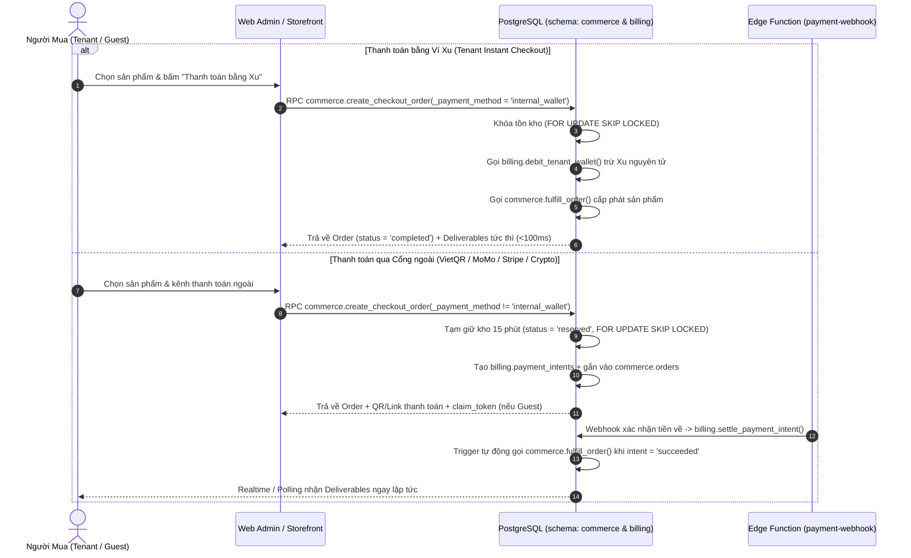

# SPEC: Kho Sản Phẩm Số, Đơn Hàng & Tự Động Giao Hàng (`digital-commerce`)

> **Module ID:** `digital-commerce`  
> **Phụ thuộc:** `payment-gateway` (`schema: billing`), `fleet-inventory` (`schema: runners`), `automation-engine` (`schema: automa`), `storage` (`schema: media`)  
> **Áp dụng cho:** `tuquet/cloud` (`supabase/plugins/commerce`) & `tuquet/admin` (`apps/web-admin/src/api/core/commerce.ts`)  
> **Trạng thái:** **ACCEPTED & IMPLEMENTED**

---

## 1. Objective (Mục Tiêu Nghiệp Vụ & Kỹ Thuật)

Xây dựng phân hệ thương mại sản phẩm số đa năng (`commerce`) cho phép **Central Platform Store** bán 4 nhóm sản phẩm số cho cả **Tenant đã đăng nhập** (trả bằng Ví Xu hoặc cổng thanh toán) và **Khách vãng lai (Guest Checkout)**:

1. **Tài khoản / License Key / Serial Text (`serial_stock`)**:
   - Quản trị kho hàng dạng dòng văn bản (`uid|pass|2fa|recovery_mail`, mã kích hoạt phần mềm, voucher).
   - **Chống bán trùng tuyệt đối (Zero Double-Selling)**: Sử dụng khóa dòng `FOR UPDATE SKIP LOCKED` để tạm giữ (`reserved`) khi tạo đơn và xuất kho (`sold`) nguyên tử ngay khi thanh toán thành công.
2. **Tài nguyên Hệ sinh thái Specter (`specter_resource`)**:
   - Tự động cấp phát tài nguyên thẳng vào Workspace (`buyer_tenant_id`) của người mua mà không cần thao tác tay:
     - `proxy_pool`: Xuất proxy từ kho và nạp thẳng vào bảng `runners.proxies` của Tenant.
     - `automa_workflow`: Nhân bản (clone) kịch bản tự động hóa mẫu vào bảng `automa.workflows` của Tenant.
     - `plan_upgrade`: Nâng cấp hoặc gia hạn gói cước trong `billing.subscriptions` của Tenant.
3. **Tệp tin số tải xuống (`digital_file`)**:
   - Liên kết với `media.assets` (tệp cài đặt, bộ dữ liệu, tài liệu PDF/ZIP), cấp quyền tải xuống có giới hạn số lượt (`max_downloads`) và thời hạn (`expires_at`).
4. **Gói nạp Xu trả trước (`wallet_credit`)**:
   - Các gói mệnh giá nạp Xu (kèm Xu thưởng `bonus_credits` nếu có) giúp Tenant nạp số dư vào `billing.wallets` thông qua các cổng thanh toán ngoài (`bank_transfer`, `e_wallet`, `card_intl`, `crypto`).

---

## 2. Scope & Architecture (Phạm Vi & Kiến Trúc)

### 2.1. Sơ Đồ Luồng Đặt Hàng & Tự Động Giao Hàng (Order & Auto-Fulfillment Flow)

### 2.2. Mô Hình Dữ Liệu (`schema: commerce` tại `cloud/supabase/plugins/commerce/install.sql`)

#### A. Kiểu liệt kê (`ENUM` trong `schema: commerce`)

- `commerce.product_type`: `'serial_stock'`, `'specter_resource'`, `'digital_file'`, `'wallet_credit'`
- `commerce.stock_status`: `'available'`, `'reserved'`, `'sold'`, `'defective'`
- `commerce.order_status`: `'pending_payment'`, `'paid'`, `'fulfilling'`, `'completed'`, `'manual_review'`, `'failed'`, `'cancelled'`, `'refunded'`

#### B. Các bảng dữ liệu cốt lõi (`schema: commerce`)

1. **`commerce.categories` (Danh mục sản phẩm)**:
   - `id UUID PRIMARY KEY DEFAULT extensions.gen_random_uuid()`
   - `slug VARCHAR(64) NOT NULL UNIQUE`
   - `name VARCHAR(128) NOT NULL`
   - `description TEXT`
   - `icon VARCHAR(64)`
   - `sort_order INT NOT NULL DEFAULT 0`
   - `is_active BOOLEAN NOT NULL DEFAULT TRUE`
   - `created_at TIMESTAMPTZ`, `updated_at TIMESTAMPTZ`

2. **`commerce.products` (Sản phẩm số)**:
   - `id UUID PRIMARY KEY DEFAULT extensions.gen_random_uuid()`
   - `category_id UUID REFERENCES commerce.categories(id) ON DELETE SET NULL`
   - `slug VARCHAR(128) NOT NULL UNIQUE`
   - `name VARCHAR(255) NOT NULL`
   - `short_description TEXT`
   - `description TEXT`
   - `product_type commerce.product_type NOT NULL`
   - `visibility VARCHAR(16) NOT NULL DEFAULT 'public' CHECK (visibility IN ('public', 'tenant_only', 'hidden'))`
   - `is_active BOOLEAN NOT NULL DEFAULT TRUE`
   - `thumbnail_url TEXT`
   - `tags TEXT[] NOT NULL DEFAULT '{}'::text[]`
   - `fulfillment_config JSONB NOT NULL DEFAULT '{}'::jsonb` (cấu hình chung: định dạng cột `uid|pass|2fa`, chính sách bảo hành, hướng dẫn sử dụng)
   - `sort_order INT NOT NULL DEFAULT 0`
   - `created_at TIMESTAMPTZ`, `updated_at TIMESTAMPTZ`

3. **`commerce.product_variants` (Biến thể / Gói mệnh giá)**:
   - `id UUID PRIMARY KEY DEFAULT extensions.gen_random_uuid()`
   - `product_id UUID NOT NULL REFERENCES commerce.products(id) ON DELETE CASCADE`
   - `sku VARCHAR(64) NOT NULL UNIQUE`
   - `name VARCHAR(128) NOT NULL`
   - `price_credits BIGINT NOT NULL CHECK (price_credits >= 0)` (Giá bán tính bằng **Xu** nguyên)
   - `compare_at_credits BIGINT CHECK (compare_at_credits IS NULL OR compare_at_credits >= price_credits)`
   - `stock_mode VARCHAR(16) NOT NULL DEFAULT 'unlimited' CHECK (stock_mode IN ('unlimited', 'serialized', 'finite_counter'))`
   - `available_stock INT NOT NULL DEFAULT 0 CHECK (available_stock >= 0)`
   - `sold_count INT NOT NULL DEFAULT 0 CHECK (sold_count >= 0)`
   - `min_qty INT NOT NULL DEFAULT 1 CHECK (min_qty >= 1)`
   - `max_qty INT NOT NULL DEFAULT 100 CHECK (max_qty >= min_qty)`
   - `fulfillment_payload JSONB NOT NULL DEFAULT '{}'::jsonb`:
     - Với `specter_resource`: `{ "resource_subtype": "automa_workflow" | "proxy_pool" | "plan_upgrade", "template_workflow_id": "...", "plan_id": "...", "duration_days": 30 }`
     - Với `digital_file`: `{ "asset_id": "...", "bucket_name": "tenant-assets", "file_path": "...", "max_downloads": 5, "expire_hours": 168 }`
     - Với `wallet_credit`: `{ "credit_amount": 1000, "bonus_credits": 100 }`
   - `is_active BOOLEAN NOT NULL DEFAULT TRUE`
   - `sort_order INT NOT NULL DEFAULT 0`
   - `created_at TIMESTAMPTZ`, `updated_at TIMESTAMPTZ`

4. **`commerce.stock_items` (Kho hàng Serial / Tài khoản / Proxy đơn chiếc)**:
   - `id UUID PRIMARY KEY DEFAULT extensions.gen_random_uuid()`
   - `variant_id UUID NOT NULL REFERENCES commerce.product_variants(id) ON DELETE CASCADE`
   - `batch_code VARCHAR(64)`
   - `secret_payload TEXT NOT NULL` (Dữ liệu nhạy cảm: `uid|pass|2fa` hoặc `host:port:user:pass`)
   - `public_hint VARCHAR(128)` (Gợi ý hiển thị an toàn, ví dụ `UID: 100098***`)
   - `metadata JSONB NOT NULL DEFAULT '{}'::jsonb`
   - `status commerce.stock_status NOT NULL DEFAULT 'available'`
   - `order_item_id UUID` (Tham chiếu tới `commerce.order_items(id)` khi `reserved` hoặc `sold`)
   - `sold_to_tenant_id UUID REFERENCES public.tenants(id) ON DELETE SET NULL`
   - `reserved_until TIMESTAMPTZ`
   - `sold_at TIMESTAMPTZ`
   - `created_at TIMESTAMPTZ`, `updated_at TIMESTAMPTZ`
   - `CONSTRAINT uq_commerce_stock_variant_secret UNIQUE (variant_id, secret_payload)` (Chống nạp trùng phôi hàng vào cùng 1 biến thể)

5. **`commerce.orders` (Đơn hàng)**:
   - `id UUID PRIMARY KEY DEFAULT extensions.gen_random_uuid()`
   - `order_code VARCHAR(32) NOT NULL UNIQUE` (Mã đơn dễ đọc: `ORD-<YYMMDD>-<6HEX>`)
   - `buyer_tenant_id UUID REFERENCES public.tenants(id) ON DELETE SET NULL` (`NULL` nếu khách vãng lai mua tại Public Storefront)
   - `buyer_user_id UUID REFERENCES public.profiles(id) ON DELETE SET NULL`
   - `buyer_email VARCHAR(255)`
   - `guest_claim_token_hash VARCHAR(64)` (SHA-256 hash của `claim_token` cấp cho Guest Checkout)
   - `payment_method VARCHAR(32) NOT NULL CHECK (payment_method IN ('internal_wallet', 'bank_transfer', 'e_wallet', 'card_intl', 'crypto'))`
   - `payment_intent_id UUID REFERENCES billing.payment_intents(id) ON DELETE SET NULL`
   - `subtotal_credits BIGINT NOT NULL CHECK (subtotal_credits >= 0)`
   - `discount_credits BIGINT NOT NULL DEFAULT 0 CHECK (discount_credits >= 0)`
   - `total_credits BIGINT NOT NULL CHECK (total_credits >= 0)`
   - `status commerce.order_status NOT NULL DEFAULT 'pending_payment'`
   - `notes TEXT`
   - `metadata JSONB NOT NULL DEFAULT '{}'::jsonb`
   - `paid_at TIMESTAMPTZ`, `fulfilled_at TIMESTAMPTZ`, `cancelled_at TIMESTAMPTZ`
   - `created_at TIMESTAMPTZ`, `updated_at TIMESTAMPTZ`

6. **`commerce.order_items` (Chi tiết dòng đơn hàng)**:
   - `id UUID PRIMARY KEY DEFAULT extensions.gen_random_uuid()`
   - `order_id UUID NOT NULL REFERENCES commerce.orders(id) ON DELETE CASCADE`
   - `product_id UUID NOT NULL REFERENCES commerce.products(id) ON DELETE RESTRICT`
   - `variant_id UUID NOT NULL REFERENCES commerce.product_variants(id) ON DELETE RESTRICT`
   - `product_name VARCHAR(255) NOT NULL`
   - `variant_name VARCHAR(128) NOT NULL`
   - `product_type commerce.product_type NOT NULL`
   - `quantity INT NOT NULL CHECK (quantity >= 1)`
   - `unit_price_credits BIGINT NOT NULL CHECK (unit_price_credits >= 0)`
   - `total_price_credits BIGINT NOT NULL CHECK (total_price_credits >= 0)`
   - `fulfilled_quantity INT NOT NULL DEFAULT 0 CHECK (fulfilled_quantity >= 0)`
   - `created_at TIMESTAMPTZ`

7. **`commerce.order_deliveries` (Sản phẩm số đã bàn giao cho người mua)**:
   - `id UUID PRIMARY KEY DEFAULT extensions.gen_random_uuid()`
   - `order_id UUID NOT NULL REFERENCES commerce.orders(id) ON DELETE CASCADE`
   - `order_item_id UUID NOT NULL REFERENCES commerce.order_items(id) ON DELETE CASCADE`
   - `buyer_tenant_id UUID REFERENCES public.tenants(id) ON DELETE SET NULL`
   - `delivery_type commerce.product_type NOT NULL`
   - `stock_item_id UUID REFERENCES commerce.stock_items(id) ON DELETE SET NULL`
   - `delivered_payload JSONB NOT NULL` (Dữ liệu bàn giao: `{ "serial": "..." }`, `{ "workflow_id": "..." }`, `{ "proxy_id": "...", "endpoint": "..." }`, `{ "asset_id": "...", "file_path": "..." }`, hoặc `{ "credited_xu": 1100 }`)
   - `download_count INT NOT NULL DEFAULT 0 CHECK (download_count >= 0)`
   - `max_downloads INT`
   - `expires_at TIMESTAMPTZ`
   - `created_at TIMESTAMPTZ`

---

## 3. Atomic RPCs & Payment-Gateway Bridge (Giao Tiếp Nguyên Tử)

Tất cả hàm RPC trong `schema: commerce` được khai báo với `SECURITY DEFINER SET search_path = ''`:

1. **`commerce.import_stock_batch(_variant_id UUID, _lines TEXT[], _batch_code VARCHAR DEFAULT NULL) RETURNS JSONB`**:
   - Chỉ cho phép `public.is_platform_admin()`.
   - Loại bỏ dòng trống, chèn vào `commerce.stock_items` với `ON CONFLICT (variant_id, secret_payload) DO NOTHING`.
   - Tính toán lại chính xác `available_stock` của `_variant_id` và trả về `{ imported_count, skipped_duplicates, available_stock }`.
2. **`commerce.release_expired_reservations(_variant_id UUID DEFAULT NULL) RETURNS INT`**:
   - Giải phóng các dòng `commerce.stock_items` có `status = 'reserved'` và `reserved_until < now()` về lại `'available'`, đồng thời hủy các đơn `pending_payment` đã hết hạn và đồng bộ `available_stock`.
3. **`commerce.create_checkout_order(_items JSONB, _payment_method VARCHAR, _buyer_tenant_id UUID DEFAULT NULL, _gateway_code VARCHAR DEFAULT NULL, _buyer_email VARCHAR DEFAULT NULL, _idempotency_key VARCHAR DEFAULT NULL) RETURNS JSONB`**:
   - Giải phóng các đặt chỗ quá hạn trước khi kiểm tra tồn kho.
   - Xác thực quyền mua:
     - Nếu `_buyer_tenant_id IS NOT NULL`: Người gọi phải có quyền `commerce:purchase` (hoặc là thành viên/admin của Tenant đó).
     - Nếu `_buyer_tenant_id IS NULL` (Guest Checkout): `_buyer_email` bắt buộc hợp lệ, `_payment_method != 'internal_wallet'`, và mọi mặt hàng phải có `visibility = 'public'` và `product_type IN ('serial_stock', 'digital_file')`.
   - Khóa dòng biến thể & kho (`FOR UPDATE SKIP LOCKED`) để giữ hàng (`status = 'reserved'`, `reserved_until = now() + interval '15 minutes'`).
   - Nếu `_payment_method = 'internal_wallet'`:
     - Trừ Xu nguyên tử qua `billing.debit_tenant_wallet()`.
     - Gọi ngay `commerce.fulfill_order(v_order_id)`.
   - Nếu `_payment_method != 'internal_wallet'`:
     - Tạo lệnh thanh toán `billing.payment_intents` (hỗ trợ cả Tenant và Guest bằng cách cho phép `billing.payment_intents.tenant_id` nullable khi gắn với đơn Guest hoặc truyền qua RPC) và trả về thông tin QR/Checkout kèm `claim_token` (nếu là Guest).
4. **`commerce.fulfill_order(_order_id UUID) RETURNS JSONB`**:
   - Khóa dòng `commerce.orders` (`FOR UPDATE`). Nếu `status = 'completed'`, trả về kết quả idempotent ngay lập tức.
   - Thực thi giao hàng theo `product_type` của từng `order_item`:
     - `serial_stock`: Chuyển các `stock_items` từ `reserved` (hoặc chọn mới bằng `FOR UPDATE SKIP LOCKED`) sang `sold`, ghi `commerce.order_deliveries`.
     - `specter_resource`:
       - `automa_workflow`: Nhân bản kịch bản vào `automa.workflows` của `buyer_tenant_id`.
       - `proxy_pool`: Xuất kho từ `stock_items` (`host:port:username:password:protocol:country`), nạp vào `runners.proxies` của `buyer_tenant_id` và ghi `commerce.order_deliveries`.
       - `plan_upgrade`: Cập nhật/kích hoạt gói cước trong `billing.subscriptions` của `buyer_tenant_id`.
     - `digital_file`: Cấp quyền truy cập tệp trong `commerce.order_deliveries`.
     - `wallet_credit`: Gọi `billing.credit_tenant_wallet()` nạp Xu vào ví của `buyer_tenant_id`.
   - Cập nhật `commerce.orders.status = 'completed'`, `fulfilled_at = now()`.
5. **Trigger liên kết tự động với `billing.payment_intents`**:
   - Trigger `trg_commerce_on_payment_intent_settled` trên bảng `billing.payment_intents`:
     - Khi `NEW.status = 'succeeded'` và `NEW.target_type = 'commerce_order'`, tự động gọi `commerce.fulfill_order(public.safe_cast_uuid(NEW.target_id))`.
     - Khi `NEW.status = 'manual_review'` và `NEW.target_type = 'commerce_order'`, tự động cập nhật `commerce.orders.status = 'manual_review'`.
6. **`commerce.get_guest_order_deliveries(_order_code VARCHAR, _claim_token VARCHAR) RETURNS JSONB`**:
   - Dành cho `anon` / `authenticated` tra cứu đơn hàng Guest bằng mã đơn + `claim_token` (băm SHA-256 khớp `guest_claim_token_hash`).

---

## 4. Boundaries & Security Guardrails (Ranh Giới & Bảo Mật)

- **Always (Luôn thực hiện)**:
  - Bật `ENABLE ROW LEVEL SECURITY` trên toàn bộ **7 bảng** trong `schema: commerce`.
  - Cô lập tuyệt đối `commerce.stock_items`: Chỉ `public.is_platform_admin()` mới có policy `SELECT / INSERT / UPDATE / DELETE` trực tiếp trên bảng `commerce.stock_items`.
  - Mọi giá tiền sản phẩm (`price_credits`, `subtotal_credits`, `total_credits`) đều tính bằng số nguyên **Xu (`BIGINT`)**.
  - Khai báo `"commerce"` trong `schemas` và `extra_search_path` của `cloud/supabase/config.toml` cũng như `AdminSchema` trong `apps/web-admin/src/api/core/supabase-client.ts`.
- **Never (Tuyệt đối cấm)**:
  - Không bao giờ trả về `secret_payload` của `commerce.stock_items` khi đơn hàng chưa ở trạng thái `'completed'`.
  - Không bao giờ trừ tồn kho bằng câu lệnh `SELECT` rồi `UPDATE` tách rời ngoài khóa dòng `FOR UPDATE` / `FOR UPDATE SKIP LOCKED`.

---

## 5. Verification & Success Criteria (Tiêu Chí Nghiệm Thu)

1. [x] **Database Plugin & Schema Audit**:
   - Plugin `cloud/supabase/plugins/commerce/` có đầy đủ `plugin.json`, `install.sql`, `uninstall.sql`, `README.md` và bài kiểm thử `cloud/tests/db/08_verify_commerce_plugin.sql`.
   - Tất cả 7 bảng trong `schema: commerce` bật RLS 100%, các hàm `SECURITY DEFINER` ghim `SET search_path = ''`.
2. [x] **Zero Double-Selling & Auto-Fulfillment**:
   - Kiểm thử xác nhận: (a) Mua `serial_stock` bằng Ví Xu trừ Xu và xuất đúng số lượng serial không trùng lặp; (b) Mua `specter_resource` (`automa_workflow`, `proxy_pool`, `plan_upgrade`) tự động tạo bản ghi trong `automa.workflows`, `runners.proxies`, `billing.subscriptions`; (c) Thanh toán đơn hàng qua `billing.settle_payment_intent` tự động kích hoạt `commerce.fulfill_order` (hoặc chuyển sang `manual_review` khi thiếu tiền/quá hạn); (d) Guest Checkout tra cứu được sản phẩm bàn giao qua `claim_token`.
3. [x] **Typed Client API (`apps/web-admin/src/api/core/commerce.ts`)**:
   - Cung cấp đầy đủ API client có kiểu tĩnh cho `categories`, `products`, `product_variants`, `orders`, `order_deliveries`, `importStockBatch`, `createCheckoutOrder`, `fulfillOrder`, `getGuestOrderDeliveries`.
   - Pass 100% unit tests trong `apps/web-admin/src/api/core/__tests__/commerce.test.ts`, `vue-tsc` (0 lỗi) và `oxlint` (0 cảnh báo).
