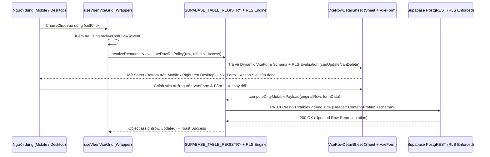

# Đặc Tả Kỹ Thuật: Kiến Trúc Động Supabase Schema + RLS Kết Hợp `VxeGrid` & `VxeForm` Detail/CRUD Sheet (`mobile-vxe-detail-sheet`)

> **Module ID:** `mobile-vxe-detail-sheet` | **Phiên bản:** `2.0.0 (Enterprise Dynamic Schema & RLS)` | **Trạng thái:** `ACCEPTED & IMPLEMENTED`  
> **Bản đồ năng lực:** [`capability-map.md`](capability-map.md) | **Kiến trúc tổng thể:** [`docs/architecture/overview.md`](../architecture/overview.md)

---

## 0. Giả Định & Quyết Định Kiến Trúc Enterprise (Assumptions & Architectural Pillars)

1. **Tư duy "Enterprise Dynamic CRUD Page với Supabase Schema + RLS + VxeTable + VxeForm":**
   - Thay vì khai báo thủ công (hardcode) danh sách trường và hàm lưu cho từng bảng trong 19 bảng `useVbenVxeGrid`, hệ thống được thiết kế như một **Engine Động hướng Schema và RLS (Schema-Driven & RLS-Aware CRUD Sheet Engine)** tích hợp trực tiếp vào tầng adapter `useVbenVxeGrid` ([`src/adapter/vxe-table.ts`](../../src/adapter/vxe-table.ts)).
2. **4 Trụ cột kiến trúc cốt lõi:**
   - **Trụ cột 1 — Sổ đăng ký Schema & RLS Tập trung (`SUPABASE_TABLE_REGISTRY` tại `src/api/core/supabase-schema-registry.ts`):**
     - Ánh xạ toàn bộ **18 bảng dữ liệu thực tế trên 5 schema PostgREST** (`public`, `automa`, `runners`, `commerce`, `billing`) phục vụ 19 `useVbenVxeGrid` instances.
     - Định nghĩa siêu dữ liệu cột (`type`: `text`, `textarea`, `number`, `boolean`, `enum`, `json`, `datetime`, `uuid`; `editable`; `required`; `enumMeta` liên kết trực tiếp tới `@vben/constants` để sinh options động qua `buildEnumFilterOptions`).
     - Định nghĩa **Ma trận Chính sách Row-Level Security (`rlsPolicy`)** khớp 100% với các `CREATE POLICY` trong Supabase SQL migrations: tự động đánh giá quyền `canUpdate(row, accessCtx)` và `canDelete(row, accessCtx)` dựa trên `EffectiveAccess` (`isSuperadmin`, `permissions`, `tenantPermissions[row.tenant_id]`, `row.my_role`, và các cờ bảo vệ dòng như `!row.is_system` trên `public.roles`, hoặc sổ cái bất biến `public.audit_logs` / `billing.wallet_transactions`).
   - **Trụ cột 2 — Bộ suy luận Schema Động (`buildDynamicVxeFormSchema`):**
     - Tự động hợp nhất: (a) các cột khai báo trên `gridOptions.columns`, (b) toàn bộ cột cơ sở dữ liệu trong `SUPABASE_TABLE_REGISTRY[resource]` (bao gồm các cột bị ẩn trên Mobile `< 640px` khi `isMobile === true`), và (c) các trường dữ liệu thực tế có mặt trong `row` (PostgREST joined/computed fields).
     - Tự động phân nhóm trên `VxeForm` thành:
       1. **Nhóm trường nghiệp vụ (`Editable Fields`):** Dùng `VxeInput`, `VxeTextarea`, `VxeNumberInput`, `VxeSwitch`, `VxeSelect` (tự động khóa sang `readonly` nếu RLS policy từ chối quyền `UPDATE` trên dòng đó).
       2. **Nhóm định danh & hệ thống (`System & Read-Only Metadata`):** `id`, `tenant_id`, các trường thống kê tính toán (`member_count`, `stock_available`...), `created_at`, `updated_at`, và khối JSONB (`new_values`, `old_values`, `public_config`) kèm nút sao chép 1 chạm.
   - **Trụ cột 3 — Bộ thực thi CRUD PostgREST Thông minh (`executeDynamicSupabasePatch` & `computeDirtyMutablePayload`):**
     - Khi người dùng sửa trên `VxeForm` và nhấn **Lưu thay đổi**, engine tự động so khớp diff (`dirty fields`) và **chỉ trích xuất các cột DB cho phép sửa (`editable: true`)**, loại bỏ hoàn toàn các trường ảo/join trước khi gửi `supabaseRequest('/rest/v1/<table>?id=eq.<id>', { method: 'PATCH', schema, preferRepresentation: true })`.
     - Đồng bộ tức thì dữ liệu trả về vào dòng đang chọn trên `VxeGrid` (`Object.assign(row, updated)`) và hỗ trợ hook `onSave` tùy chỉnh nếu màn hình có nghiệp vụ đặc thù.
   - **Trụ cột 4 — Tích hợp Zero-Boilerplate vào `useVbenVxeGrid` & Tự động kế thừa Action Buttons (`Auto-Slot Forwarding`):**
     - HOC bọc trong `useVbenVxeGrid` (`src/adapter/vxe-table.ts`) tự động bắt sự kiện `cellClick` (bỏ qua khi bấm vào nút/link nội dòng qua `isInteractiveCellClick`), mở `VxeRowDetailSheet` (`side="bottom"` trên Mobile, `side="right"` trên Desktop), và **tự động kế thừa slot cột thao tác của bảng (`#actions-cell`, `#action-cell`, `#role-actions-cell`, `#detail-cell`)** để hiển thị đầy đủ các nút Action nghiệp vụ ngay trong `SheetFooter` mà không cần viết lặp lại!

---

## 1. Mục Tiêu & Phạm Vi (Objective & Scope)

- **Mục tiêu:**
  1. Khi ở phiên bản Mobile (hoặc khi click vào dòng dữ liệu / nút chi tiết trên bất kỳ bảng `useVbenVxeGrid` nào), hệ thống mở nhất quán một **Sheet Chi Tiết & Sửa Nhanh (`VxeRowDetailSheet`)**.
  2. Bên trong Sheet sử dụng **`VxeForm`** hiển thị đầy đủ 100% trường của bản ghi (khắc phục triệt để việc ẩn cột phụ trên màn hình `< 640px`), tự động kiểm tra **Supabase RLS Policy** để cho phép sửa + lưu (`PATCH`) các trường hợp lệ, đồng thời hiển thị đầy đủ các **Action Buttons** của dòng đó.
  3. Rà soát và áp dụng đồng bộ trên toàn bộ **19 bảng `useVbenVxeGrid` thuộc 15 màn hình** của `apps/web-admin`.

---

## 2. Ngăn Xếp Công Nghệ & Lệnh Thực Thi (Tech Stack & Commands)

### 2.1. Ngăn xếp công nghệ

- **Frontend Core:** Vue 3.5+, TypeScript 5.8+, Tailwind CSS v4.
- **UI & VXE Engine:**
  - `@tuquet/vue-ui`: `Sheet`, `SheetContent`, `SheetHeader`, `SheetTitle`, `SheetDescription`, `SheetFooter`, `Badge`, `VbenButton`.
  - `#/adapter/vxe-table` (`vxe-table` + `vxe-pc-ui`): `useVbenVxeGrid`, `VxeForm`, `VxeFormItem`, `VxeInput`, `VxeTextarea`, `VxeSelect`, `VxeSwitch`, `VxeNumberInput`.
- **Data & Security Layer:**
  - `supabaseRequest({ schema, preferRepresentation })` (`src/api/core/supabase-client.ts`).
  - `getEffectiveAccessApi()` (`src/api/core/access.ts`).
  - `@vben/constants` & `#/constants` (`buildEnumFilterOptions`, `StatusTone`).

### 2.2. Lệnh kiểm tra & vận hành

```bash
# Kiểm tra khóa đa ngôn ngữ đối xứng en-US & vi-VN
pnpm --filter @vben/web-admin run check:i18n

# Chạy bộ kiểm thử đơn vị (Vitest)
pnpm --filter @vben/web-admin exec vitest run

# Kiểm tra kiểu tĩnh TypeScript toàn ứng dụng
pnpm --filter @vben/web-admin run typecheck

# Đóng gói bản dựng local để kiểm thử trực tiếp trên Tailscale (http://100.68.217.61/)
pnpm run build:local
```

---

## 3. Kiến Trúc Tệp & Ma Trận 19 Bảng Supabase RLS (Project Structure & Matrix)

### 3.1. Cấu trúc tệp

```text
packages/effects/plugins/src/vxe-table/
└── init.ts                                             # [CẬP NHẬT] Đăng ký VxeSwitch, VxeTextarea cho VxeForm

apps/web-admin/src/
├── api/core/
│   ├── supabase-schema-registry.ts                     # [MỚI] Sổ đăng ký 18 bảng Supabase (5 schemas), RLS policies, Enum & CRUD PATCH/DELETE
│   └── __tests__/
│       └── supabase-schema-registry.test.ts            # [MỚI] Unit tests kiểm thử RLS evaluation, schema inference & dirty diffing
├── components/vxe-detail-sheet/
│   ├── index.ts                                        # [MỚI] Barrel export
│   ├── types.ts                                        # [MỚI] Types cho Dynamic Schema, RLS state & Detail Sheet options
│   ├── vxe-row-detail-sheet.vue                        # [MỚI] Enterprise Sheet + VxeForm + RLS Badge + Auto-Forwarded Action Footer
│   └── __tests__/
│       └── vxe-row-detail-sheet.test.ts                # [MỚI] Unit tests cho component & isInteractiveCellClick
├── adapter/
│   └── vxe-table.ts                                    # [CẬP NHẬT] Nâng cấp useVbenVxeGrid tích hợp tự động VxeRowDetailSheet & auto-slot forwarding
└── views/                                              # [CẬP NHẬT] Rà soát & gắn kết resource/actions chuẩn xác trên 15 views (19 grids)
```

### 3.2. Ma trận 19 Bảng `useVbenVxeGrid` $\leftrightarrow$ Supabase Schema & Chính sách RLS

| # | Tệp View (`src/views/...`) | Grid | Supabase Resource (`schema.table`) | Chính sách RLS (`UPDATE` / `DELETE`) | Các cột DB cho phép sửa qua `VxeForm` (`PATCH`) | Slot Action kế thừa tự động |
| :-: | :-- | :-- | :-- | :-- | :-- | :-- |
| 1 | [`tenants/index.vue`](../../src/views/tenants/index.vue) | `Grid` | `public.tenants` | `tenants_update_owner_or_admin`: Superadmin hoặc `row.my_role IN ('owner','admin')` hoặc `tenants.update` | `name`, `slug`, `plan`, `status`, `logo_url` | `#actions-cell` |
| 2 | [`automation/workflows/index.vue`](../../src/views/automation/workflows/index.vue) | `Grid` | `automa.workflows` | `workflows_manage`: Superadmin hoặc quyền `automa.workflows.manage` | `name`, `description`, `version`, `status` | `#actions-cell` |
| 3 | [`automation/runs/index.vue`](../../src/views/automation/runs/index.vue) | `Grid` | `automa.campaign_runs` | `campaigns_run`: Superadmin hoặc quyền `automa.campaigns.run` | `name`, `status` | `#actions-cell` |
| 4 | [`automation/devices/index.vue`](../../src/views/automation/devices/index.vue) | `Grid` | `runners.devices` | `devices_manage`: Superadmin hoặc quyền `runners.manage` | `name`, `status`, `os_info`, `ip_address` | `#actions-cell` |
| 5 | [`automation/browsers/index.vue`](../../src/views/automation/browsers/index.vue) | `Grid` | `runners.browsers` | `browsers_manage`: Superadmin hoặc quyền `runners.manage` | `name`, `status`, `os_platform`, `browser_version`, `proxy_id` | `#actions-cell` (hoặc copy ID) |
| 6 | [`automation/proxies/index.vue`](../../src/views/automation/proxies/index.vue) | `Grid` | `runners.proxies` | `proxies_manage`: Superadmin hoặc quyền `runners.manage` | `host`, `port`, `protocol`, `status`, `country_code`, `is_residential` | `#actions-cell` (hoặc copy proxy) |
| 7 | [`commerce/orders/index.vue`](../../src/views/commerce/orders/index.vue) | `Grid` | `commerce.orders` | `orders_tenant_or_admin`: Superadmin sửa `status`, `buyer_email`; Tenant buyer xem & sửa `buyer_email` khi `pending` | `buyer_email`, `status` | `#action-cell` |
| 8 | [`commerce/wallet/index.vue`](../../src/views/commerce/wallet/index.vue) | `Grid` | `billing.wallet_transactions` | `rls_append_only_ledger`: Sổ cái tài chính bất biến (Chỉ đọc 100% theo RLS) | _(Read-only ledger)_ | `#action-cell` (Copy Ref) |
| 9 | [`commerce/admin/index.vue`](../../src/views/commerce/admin/index.vue) | `ProductsGrid` | `commerce.products` | `products_platform_admin`: Yêu cầu Platform Superadmin | `name`, `slug`, `product_type`, `visibility`, `is_active`, `short_description`, `sort_order` | `#action-cell` |
| 10 | [`commerce/admin/index.vue`](../../src/views/commerce/admin/index.vue) | `OrdersGrid` | `commerce.orders` | `orders_platform_admin`: Yêu cầu Platform Superadmin | `status`, `buyer_email` | `#action-cell` |
| 11 | [`commerce/admin/index.vue`](../../src/views/commerce/admin/index.vue) | `IntentsGrid` | `billing.payment_intents` | `payment_intents_platform_admin`: Yêu cầu Platform Superadmin | `status`, `credits_amount` | `#action-cell` |
| 12 | [`commerce/admin/index.vue`](../../src/views/commerce/admin/index.vue) | `GatewaysGrid` | `billing.payment_gateways` | `payment_gateways_platform_admin`: Yêu cầu Platform Superadmin | `display_name`, `rate_per_credit`, `is_active`, `sort_order`, `public_config` | `#action-cell` |
| 13 | [`system/plugins/index.vue`](../../src/views/system/plugins/index.vue) | `Grid` | `public.system_plugins` | `system_plugins_manage_admin`: Superadmin (Khóa `status` nếu `is_core === true`) | `name`, `description`, `version`, `status` | `#actions-cell` |
| 14 | [`system/plans/index.vue`](../../src/views/system/plans/index.vue) | `Grid` | `billing.plans` | `plans_platform_admin`: Yêu cầu Platform Superadmin | `name`, `description`, `price_monthly_usd`, `price_yearly_usd`, `max_members`, `max_storage_mb`, `max_monthly_runs`, `is_active` | `#actions-cell` |
| 15 | [`system/users/index.vue`](../../src/views/system/users/index.vue) | `Grid` | `public.profiles` | `profiles_self_or_superadmin`: Superadmin hoặc chính chủ (`auth.uid() = id`) | `full_name`, `avatar_url` | `#actions-cell` |
| 16 | [`system/roles/index.vue`](../../src/views/system/roles/index.vue) | `RolesGrid` | `public.roles` | `roles_manage_custom`: Khóa chỉ đọc nếu `row.is_system === true`; cho phép sửa nếu Custom Role | `name`, `description` | `#role-actions-cell` |
| 17 | [`system/roles/index.vue`](../../src/views/system/roles/index.vue) | `PermissionsGrid` | `public.permissions` | `permissions_catalog_admin`: Từ điển quyền hạn hệ thống (Superadmin sửa `description`) | `description`, `module` | `#perm-actions-cell` |
| 18 | [`system/subscriptions/index.vue`](../../src/views/system/subscriptions/index.vue) | `Grid` | `billing.subscriptions` | `subscriptions_platform_admin`: Yêu cầu Platform Superadmin | `plan_id`, `status`, `cancel_at_period_end` | `#actions-cell` |
| 19 | [`system/audit-logs/index.vue`](../../src/views/system/audit-logs/index.vue) | `Grid` | `public.audit_logs` | `rls_append_only_ledger`: Nhật ký kiểm toán bất biến (Chỉ đọc 100% theo RLS) | _(Read-only audit log + JSON inspector)_ | `#detail-cell` |

---

## 4. Quy Chuẩn Code & Luồng Hoạt Động (Code Style & Data Flow)



---

## 5. Chiến Lược Kiểm Thử & Ranh Giới (Testing & Boundaries)

### 5.1. Kiểm thử đơn vị (Vitest)

- `src/api/core/__tests__/supabase-schema-registry.test.ts`:
  - Kiểm thử đầy đủ 18 bảng trong `SUPABASE_TABLE_REGISTRY` (khớp schema, primaryKey, editableColumns).
  - Kiểm thử `evaluateRowRlsPolicy` với các kịch bản: Superadmin, Tenant Owner/Admin, Standard Member, System Role (`is_system: true` bị khóa), Core Plugin (`is_core: true`), và Immutable Ledger (`audit_logs`, `wallet_transactions`).
  - Kiểm thử `buildDynamicVxeFormSchema` tự động suy luận đầy đủ trường từ `gridColumns` + `SUPABASE_TABLE_REGISTRY` + `row` (bao gồm các cột bị ẩn trên Mobile).
  - Kiểm thử `computeDirtyMutablePayload` chỉ lấy các trường `editable: true` có thay đổi, loại bỏ hoàn toàn các trường ảo/join.
- `src/components/vxe-detail-sheet/__tests__/vxe-row-detail-sheet.test.ts`:
  - Kiểm thử `isInteractiveCellClick`, render `VxeForm` theo quyền RLS, và luồng lưu `PATCH`.

### 5.2. Ranh giới (Boundaries)

- **Luôn thực hiện:** Tuân thủ nghiêm ngặt `Sentence case`, thang chữ 7 bậc (`text-2xs` đến `text-2xl`), đối xứng đa ngôn ngữ `en-US` / `vi-VN`, và chỉ gửi `PATCH` trên các cột DB thực sự thay đổi.
- **Không thực hiện:** Không chạy `git push`, không cho phép sửa các cột định danh bất biến (`id`, `tenant_id`, `created_at`) hoặc các bảng sổ cái bất biến (`audit_logs`, `wallet_transactions`).

---

## 6. Tiêu Chí Nghiệm Thu (Success Criteria)

- [ ] `SUPABASE_TABLE_REGISTRY` định nghĩa đầy đủ 18 bảng trên 5 schemas (`public`, `automa`, `runners`, `commerce`, `billing`) kèm RLS policy evaluator và Enum metadata.
- [ ] `useVbenVxeGrid` (`src/adapter/vxe-table.ts`) tự động tích hợp `VxeRowDetailSheet` (`Sheet` + `VxeForm`) và tự động chuyển tiếp slot Action của dòng vào chân Sheet.
- [ ] Toàn bộ **19 bảng `useVbenVxeGrid` trên 15 trang** hoạt động đồng nhất: chạm vào dòng trên Mobile mở Bottom Sheet hiển thị đủ 100% trường bằng `VxeForm`, hiển thị huy hiệu quyền RLS, cho phép sửa + lưu `PATCH` trực tiếp vào Supabase, và hiển thị đầy đủ các nút Action.
- [ ] Pass 100% `check:i18n`, `vitest run`, `typecheck`, và `pnpm run build:local`.
