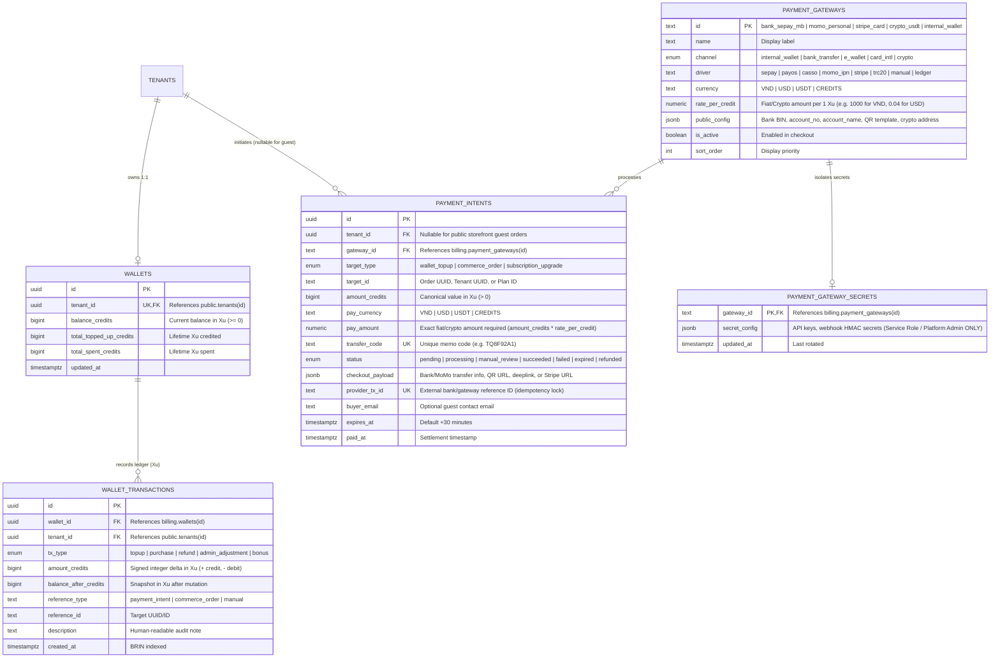

# Spec: Multi-Platform Payment Gateway & Tenant Wallet (`payment-gateway`)

> **Mã đặc tả:** `SPEC-payment-gateway`  
> **Module id:** `payment-gateway` (xem [`capability-map.md`](capability-map.md))  
> **Kiến trúc nguồn:** [`docs/architecture/overview.md`](../architecture/overview.md)  
> **Target Repository:** `cloud/` (`schema: billing` trong `supabase/plugins/subscriptions/` & `supabase/functions/payment-webhook/`) + `admin/` (`apps/web-admin/src/api/core/billing.ts`)  
> **Trạng thái:** **ACCEPTED (ĐÃ PHÊ DUYỆT)**

---

## 1. Objective

Build an **Extensible Multi-Platform Payment Gateway & Prepaid Wallet Engine** in `tuquet/cloud` by expanding the `billing` schema (`subscriptions` plugin) and introducing a unified Webhook Reconciliation Edge Function.

### Why We Are Building This

Currently, `billing.subscriptions` tracks static SaaS plans (`free`, `pro`, `enterprise`) with placeholder Stripe columns, lacking real payment collection for Vietnam domestic transfers, e-wallets, crypto, or an internal prepaid balance. To power the upcoming **Digital Products Store (`digital-commerce`)**, **Prepaid Credit Top-ups**, and **Self-Serve Plan Upgrades** across Web Admin, Public Storefront, and CLI, the platform needs a single provider-agnostic payment core.

### User Stories

1. **As a Buyer (Tenant or Public Storefront Guest)**, I can choose to pay for an order or top up my balance via **Domestic Bank Transfer** (manual copy of account/memo or Napas247/VietQR scan), **E-Wallet** (MoMo / ZaloPay transfer or deep-link), **International Card** (Stripe), **Crypto** (USDT TRC20/BEP20 / Binance Pay), or my **Prepaid Tenant Wallet** (instant 1-click deduction).
2. **As a Buyer**, as soon as my bank/MoMo/crypto transfer containing the short memo code (e.g., `TQ8F92A1`) is confirmed by the webhook listener, my payment screen updates in real time and my digital product or wallet credit is delivered automatically within seconds.
3. **As a Platform Administrator**, I can add, enable/disable, or rotate payment gateways (bank accounts, MoMo numbers, webhook providers like SePay/PayOS/Casso/Web2M, Stripe keys, USDT wallets) and manually approve/refund pending transactions from the back-office without redeploying backend code.

---

## 2. Tech Stack

- **Database & Core Ledger**: PostgreSQL 15+ (Supabase), isolated inside `schema: billing` (`cloud/supabase/plugins/subscriptions/`).
- **Authorization & RLS**: Zero-recursion $O(1)$ Row-Level Security (`public.is_tenant_member`, `public.has_tenant_permission`, `public.is_platform_admin`) and `SECURITY DEFINER` RPCs with `SET search_path = ''`.
- **Webhook Ingestion Runtime**: Supabase Edge Functions (Deno 1.4x / TypeScript) at `cloud/supabase/functions/payment-webhook/index.ts`.
- **Event Distribution**: PostgreSQL ACID Transactional Outbox (`events.outbox` via `events.emit_event`) + Supabase Realtime Postgres Changes on `billing.payment_intents`.
- **Testing Runner**: PowerShell 5.1+ / Bash SQL test runner (`cloud/scripts/test_db.ps1`) + Node.js integration tests (`cloud/scripts/testing/`).

---

## 3. Commands

```powershell
# 1. Apply updated subscriptions/billing plugin to local Supabase Docker container
powershell -ExecutionPolicy Bypass -File cloud/scripts/plugins/apply_plugins.ps1 -Target local -Plugin subscriptions -Action install

# 2. Run database schema, RLS, wallet ledger, and payment intent unit/integration tests
powershell -ExecutionPolicy Bypass -File cloud/scripts/test_db.ps1

# 3. Execute targeted SQL verification for billing & payment-gateway
Get-Content cloud/tests/db/04_verify_subscriptions_plugin.sql -Raw | docker exec -i supabase_db_tuquet-cloud psql -U postgres -d postgres

# 4. Serve payment-webhook Edge Function locally for webhook signature & reconciliation testing
supabase functions serve payment-webhook --no-verify-jwt --workdir cloud
```

---

## 4. Project Structure

```text
cloud/
├── supabase/
│   ├── plugins/
│   │   └── subscriptions/
│   │       ├── plugin.json             # Updated manifest: adds wallets, transactions, gateways, intents
│   │       ├── install.sql             # Updated DDL/DML: schema billing tables, RLS, RPCs, seed gateways
│   │       ├── uninstall.sql           # Clean teardown of schema billing
│   │       └── README.md               # Updated ERD and Payment Adapter documentation
│   └── functions/
│       └── payment-webhook/
│           ├── index.ts                # Unified webhook router (/payment-webhook?provider=<driver>)
│           └── adapters/
│               ├── types.ts            # Normalized WebhookSettlementEvent interface
│               ├── bank-webhook.ts     # SePay, PayOS, Casso, Web2M memo parser & HMAC/token verifier
│               ├── ewallet-webhook.ts  # MoMo IPN, ZaloPay callback, and personal e-wallet parser
│               ├── stripe-webhook.ts   # Stripe signature verification & checkout.session.completed
│               └── crypto-webhook.ts   # USDT TRC20/BEP20 & Binance Pay webhook verifier
└── tests/
    └── db/
        └── 04_verify_subscriptions_plugin.sql  # Expanded test suite for wallets & payment intents
```

---

## 5. Architecture, Data Model & Code Style

### 5.1. Database Schema Additions (`schema: billing`)

All internal balances, product prices, and ledger entries use **Xu (`credits` — `BIGINT`)** as the single virtual currency unit (e.g., default `1 Xu = 1,000 VND` or `1 Xu = $0.04 USD`, configurable per gateway via `rate_per_credit`).



### 5.2. SQL & RPC Code Style (Hardened `SECURITY DEFINER` Pattern)

All functions in `schema: billing` MUST enforce `SET search_path = ''`, use fully-qualified object names, and rely on row-level `FOR UPDATE` locks. Transfers arriving **after `expires_at`** or with **underpaid amounts** automatically transition to `status = 'manual_review'` until a Platform Admin explicitly approves them (`_force_approve = TRUE`):

```sql
CREATE OR REPLACE FUNCTION billing.settle_payment_intent(
    _intent_id UUID DEFAULT NULL,
    _transfer_code TEXT DEFAULT NULL,
    _provider_tx_id TEXT DEFAULT NULL,
    _actual_pay_amount NUMERIC DEFAULT NULL,
    _raw_metadata JSONB DEFAULT '{}'::jsonb,
    _force_approve BOOLEAN DEFAULT FALSE
)
RETURNS JSONB
LANGUAGE plpgsql
SECURITY DEFINER
SET search_path = ''
AS $$
DECLARE
    v_intent billing.payment_intents%ROWTYPE;
    v_new_balance BIGINT;
    v_now TIMESTAMPTZ := timezone('utc'::text, now());
BEGIN
    -- 1. Authorize caller: Only service_role (Webhook Edge Function) or Platform Admin
    IF current_setting('request.jwt.claim.role', true) IS DISTINCT FROM 'service_role'
       AND NOT public.is_platform_admin() THEN
        RAISE EXCEPTION 'Unauthorized: Only payment webhook service or platform admin can settle intents'
            USING ERRCODE = '42501';
    END IF;

    -- 2. Locate and lock the payment intent atomically
    SELECT * INTO v_intent
    FROM billing.payment_intents pi
    WHERE (_intent_id IS NOT NULL AND pi.id = _intent_id)
       OR (_transfer_code IS NOT NULL AND pi.transfer_code = UPPER(TRIM(_transfer_code)))
    FOR UPDATE;

    IF NOT FOUND THEN
        RETURN jsonb_build_object('settled', false, 'reason', 'intent_not_found');
    END IF;

    -- 3. Idempotency guard: If already succeeded, return early without double-crediting
    IF v_intent.status = 'succeeded' THEN
        RETURN jsonb_build_object('settled', true, 'idempotent', true, 'intent_id', v_intent.id);
    END IF;

    IF v_intent.status NOT IN ('pending', 'processing', 'manual_review', 'expired') THEN
        RETURN jsonb_build_object('settled', false, 'reason', 'invalid_intent_state', 'status', v_intent.status);
    END IF;

    -- 4. Late transfer guard: If expired (> 30m) and not force-approved by Admin, hold in manual_review
    IF (v_intent.status = 'expired' OR v_now > v_intent.expires_at) AND NOT _force_approve THEN
        UPDATE billing.payment_intents
        SET status = 'manual_review',
            provider_tx_id = COALESCE(_provider_tx_id, provider_tx_id),
            checkout_payload = checkout_payload || jsonb_build_object(
                'review_reason', 'late_transfer_after_expiry',
                'received_amount', _actual_pay_amount,
                'received_at', v_now,
                'webhook_meta', _raw_metadata
            ),
            updated_at = v_now
        WHERE id = v_intent.id;

        RETURN jsonb_build_object('settled', false, 'reason', 'expired_held_for_manual_review', 'intent_id', v_intent.id);
    END IF;

    -- 5. Underpaid guard: If paid amount < expected pay_amount and not force-approved, hold in manual_review
    IF _actual_pay_amount IS NOT NULL AND _actual_pay_amount < v_intent.pay_amount AND NOT _force_approve THEN
        UPDATE billing.payment_intents
        SET status = 'manual_review',
            provider_tx_id = COALESCE(_provider_tx_id, provider_tx_id),
            checkout_payload = checkout_payload || jsonb_build_object(
                'review_reason', 'underpaid',
                'expected_amount', v_intent.pay_amount,
                'received_amount', _actual_pay_amount,
                'webhook_meta', _raw_metadata
            ),
            updated_at = v_now
        WHERE id = v_intent.id;

        RETURN jsonb_build_object('settled', false, 'reason', 'underpaid_held_for_manual_review', 'expected', v_intent.pay_amount, 'received', _actual_pay_amount);
    END IF;

    -- 6. Mark intent as succeeded
    UPDATE billing.payment_intents
    SET status = 'succeeded',
        provider_tx_id = COALESCE(_provider_tx_id, provider_tx_id),
        paid_at = v_now,
        updated_at = v_now
    WHERE id = v_intent.id;

    -- 7. Execute target settlement action (wallet_topup | subscription_upgrade | commerce_order)
    IF v_intent.target_type = 'wallet_topup' AND v_intent.tenant_id IS NOT NULL THEN
        v_new_balance := billing.credit_tenant_wallet(
            v_intent.tenant_id,
            v_intent.amount_credits,
            'topup',
            'payment_intent',
            v_intent.id::text,
            'Nap ' || v_intent.amount_credits || ' Xu qua ' || v_intent.gateway_id || ' (' || v_intent.transfer_code || ')'
        );
    ELSIF v_intent.target_type = 'subscription_upgrade' AND v_intent.tenant_id IS NOT NULL THEN
        UPDATE billing.subscriptions
        SET plan_id = v_intent.target_id,
            status = 'active',
            current_period_start = v_now,
            current_period_end = v_now + INTERVAL '30 days',
            updated_at = v_now
        WHERE tenant_id = v_intent.tenant_id;
    END IF;

    -- 8. Emit transactional outbox event for downstream consumers (e.g. commerce.orders fulfillment)
    IF EXISTS (SELECT 1 FROM information_schema.routines WHERE routine_schema = 'events' AND routine_name = 'emit_event')
       AND v_intent.tenant_id IS NOT NULL THEN
        PERFORM events.emit_event(
            v_intent.tenant_id,
            'billing.payment.succeeded',
            jsonb_build_object(
                'intent_id', v_intent.id,
                'target_type', v_intent.target_type,
                'target_id', v_intent.target_id,
                'amount_credits', v_intent.amount_credits,
                'gateway_id', v_intent.gateway_id
            )
        );
    END IF;

    RETURN jsonb_build_object('settled', true, 'idempotent', false, 'intent_id', v_intent.id, 'target_type', v_intent.target_type, 'target_id', v_intent.target_id);
END;
$$;
```

### 5.3. Pluggable Webhook Adapter Style (`supabase/functions/payment-webhook/`)

Each payment provider implements a pure, stateless parser that extracts `{ transferCode, intentId, providerTxId, paidAmount, currency }` from incoming bank/MoMo/Stripe/Crypto webhooks after verifying the cryptographic signature or bearer token against `billing.payment_gateway_secrets`:

```typescript
export interface NormalizedWebhookSettlement {
  intentId?: string;
  transferCode?: string; // Extracted via regex /\b(TQ[A-Z0-9]{6})\b/i from bank/MoMo transfer content
  providerTxId: string;
  paidAmount: number;
  currency: 'VND' | 'USD' | 'USDT';
  rawPayload: Record<string, unknown>;
}

export interface PaymentWebhookAdapter {
  readonly driver: string;
  verifyAndParse(
    req: Request,
    rawBody: string,
    secretConfig: Record<string, string>,
  ): Promise<NormalizedWebhookSettlement | null>;
}
```

---

## 6. Testing Strategy

1. **Database Schema & RLS Verification (`cloud/tests/db/04_verify_subscriptions_plugin.sql`)**:
   - Verify all 8 tables in `schema: billing` (`plans`, `subscriptions`, `usage_meters`, `payment_gateways`, `payment_gateway_secrets`, `wallets`, `wallet_transactions`, `payment_intents`) exist and have `rowsecurity = true`.
   - Verify `anon` and normal `authenticated` tenants **CANNOT** `SELECT` from `billing.payment_gateway_secrets` (0 rows / permission denied).
2. **Wallet & Concurrency Unit Tests (Xu / `BIGINT` Ledger)**:
   - Verify `billing.credit_tenant_wallet` and `billing.debit_tenant_wallet` maintain exact integer `Xu` invariants (`SUM(wallet_transactions.amount_credits) == wallets.balance_credits`).
   - Verify debiting more `Xu` than available `balance_credits` raises an insufficient funds exception (`P0001`) and rolls back cleanly.
3. **Payment Intent, Expiry Manual Review & Idempotency Tests**:
   - Create intents across `bank_transfer`, `e_wallet` (MoMo), `card_intl` (Stripe), `crypto` (USDT), and `internal_wallet`.
   - Call `billing.settle_payment_intent` twice with the same `_transfer_code` and `_provider_tx_id`; verify the second call returns `{"settled": true, "idempotent": true}` and credits `Xu` **strictly once**.
   - Test late payment (`now() > expires_at`) and underpayment (`_actual_pay_amount < pay_amount`): verify status transitions to `'manual_review'` and is only settled when Platform Admin calls with `_force_approve = TRUE`.

---

## 7. Boundaries

- **Always do:**
  - Enforce `SET search_path = ''` on every SQL function and trigger in `schema: billing`.
  - Keep gateway API keys and webhook HMAC secrets strictly inside `billing.payment_gateway_secrets` (accessible only to `service_role` and `public.is_platform_admin()`).
  - Enforce idempotency on `provider_tx_id` and `intent.status = 'succeeded'` so duplicate webhook retries never double-credit `Xu` or double-fulfill an order.
  - Follow ASCII-only rules in all PowerShell scripts (`*.ps1`) and SQL test scripts.
- **Ask first:**
  - Adding any third-party NPM/Deno SDK dependency to `supabase/functions/payment-webhook` (prefer native Web Crypto `crypto.subtle` for HMAC-SHA256 verification per Ponytail/YAGNI standard).
  - Modifying existing columns on `billing.plans` or `billing.subscriptions` that could break existing Admin UI views.
- **Never do:**
  - Never hardcode real bank account numbers, real MoMo phone numbers, or live webhook secrets in SQL migrations or seed files (use RFC-compliant placeholders / test accounts in `install.sql`).
  - Never allow client-side callers (`anon` or non-admin `authenticated`) to call `billing.settle_payment_intent` or directly `UPDATE` `billing.wallets.balance_credits`.
  - Never include local workstation paths in documentation or comments.

---

## 8. Success Criteria

- [x] `cloud/supabase/plugins/subscriptions/install.sql` cleanly creates `payment_gateways`, `payment_gateway_secrets`, `wallets`, `wallet_transactions`, and `payment_intents` with 100% RLS coverage and idempotent re-execution.
- [x] All internal wallet balances and ledger entries use integer **Xu (`BIGINT`)**, with automatic fiat/crypto calculation (`pay_amount = amount_credits * rate_per_credit`).
- [x] Default seeded gateways include `internal_wallet`, `bank_vietqr` (Bank Transfer + QR), `momo_ewallet` (MoMo Transfer/QR), `stripe_card` (International Card), and `crypto_usdt` (USDT TRC20/BEP20).
- [x] `billing.create_payment_intent` supports both authenticated `tenant_id` and guest orders (`tenant_id IS NULL`), generating deterministic checkout payloads (bank transfer details + QR URL, MoMo info, or immediate `Xu` wallet deduction).
- [x] `billing.settle_payment_intent` holds late (`> expires_at`) or underpaid transfers in `status = 'manual_review'`, settles valid transfers to `'succeeded'`, updates `billing.wallets` + `billing.wallet_transactions` (for top-ups), and is 100% idempotent on repeated calls.
- [x] `cloud/supabase/functions/payment-webhook/index.ts` verifies webhook signatures/tokens using native Web Crypto and settles matching `transfer_code` (`TQxxxxxx`) or `intent_id` records.
- [x] `cloud/scripts/test_db.ps1` and `cloud/scripts/testing/test_payment_webhook_adapters.mjs` pass 100% of verification assertions.

---

## 9. Resolved Decisions

1. **Đơn vị tiền tệ gốc (Base Ledger Currency)**: Sử dụng **Xu (`credits` — kiểu nguyên `BIGINT`)** làm đơn vị tiền tệ ảo chuẩn trong toàn hệ thống (Ví Tenant, giá Sản phẩm số, Đơn hàng). Mỗi cổng thanh toán cấu hình tỷ giá quy đổi `rate_per_credit` (mặc định `1 Xu = 1,000 VND` cho Ngân hàng/MoMo, `1 Xu = 0.04 USD/USDT` cho Stripe/Crypto).
2. **Xử lý giao dịch quá hạn (`> 30 phút`) hoặc thiếu tiền**: Tự động chuyển vào trạng thái **`manual_review` (Chờ duyệt tay)** kèm đầy đủ metadata giao dịch để Platform Admin kiểm tra và bấm duyệt thủ công (`_force_approve = TRUE`) trên giao diện quản trị.
