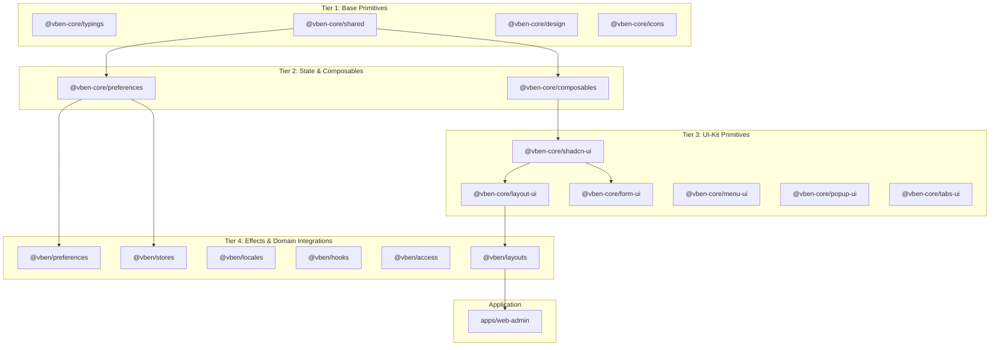

# Spec: Platform Foundation & Monorepo Architecture (Module `platform-foundation`)

> **Mã đặc tả:** `SPEC-platform-foundation`  
> **Module id:** `platform-foundation` (xem [`capability-map.md`](capability-map.md)) — **ĐÃ HOÀN THÀNH**  
> **Kiến trúc nguồn:** [`docs/architecture/overview.md`](../architecture/overview.md)  
> **Trạng thái:** **ACTIVE & ACCEPTED**

---

## 1. Mục Tiêu & Phạm Vi (Objective & Scope)

Module `platform-foundation` thiết lập và chuẩn hóa toàn bộ nền tảng kỹ thuật cho ứng dụng Tuquet Admin (`apps/web-admin` / `admin.tuquet.com`), bao gồm cấu trúc phân tầng monorepo 39 packages, hạ tầng build cục bộ không phát sinh rủi ro tài nguyên CI (`build:local`), cơ chế kiểm soát vòng đời PWA (Service Worker anti-cache & auto-update), và thực thi cổng kiểm định chất lượng 3 bước trước khi chuyển giao mã nguồn.

### Trong phạm vi:

1. **Kiến Trúc Monorepo & Phân Tầng Package:**
   - Chuẩn hóa ranh giới 39 packages theo cấu trúc 4 tầng: Base Primitives (`@vben-core/*`), State & Composables, UI-Kit Primitives, và Effects/Domain Integrations (`@vben/*`).
   - Quản lý phiên bản tập trung qua `pnpm-workspace.yaml` bằng catalog (`catalog:`), loại bỏ hardcode version số lẻ tại package con.
2. **Hạ Tầng Build Cục Bộ & Xem Trước Tailscale (`build:local`):**
   - Tự động hóa kiểm tra tài nguyên đĩa cứng VPS ($\le 85\%$), dọn cache `.turbo` khi cần thiết.
   - Giới hạn bộ nhớ Node heap `--max-old-space-size=4096` tránh lỗi OOM khi biên dịch DTS.
   - Ghi nhận telemetry bản build vào `apps/web-admin/dist/.build-meta.json`.
   - Nạp lại Nginx graceful reload và phục vụ qua mạng Tailscale Mesh (`http://100.68.217.61/`) với Zero WAN Port Exposure.
3. **Quản Lý Vòng Đời PWA & Header Chống Cache:**
   - Cấu hình Vite PWA với `registerType: 'autoUpdate'`, `workbox.skipWaiting: true`, và `workbox.clientsClaim: true`.
   - Nginx phục vụ `sw.js`, `manifest.webmanifest`, và `_app-config-*.js` với `Cache-Control: no-cache, no-store, must-revalidate; Expires: 0`.
4. **Cổng Kiểm Định Chất Lượng Pre-Push 3 Bước:**
   - Bước 1 (Typecheck): `pnpm run check:type` (`turbo run typecheck`) đạt 0 lỗi trên 39 packages.
   - Bước 2 (Lint & Format): `oxfmt` + `eslint` + `stylelint` đạt 0 lỗi.
   - Bước 3 (Admin Build): `pnpm run build:admin` đóng gói thành công.

---

## 2. Kiến Trúc Phân Tầng Monorepo (Package Topology)

Hệ thống monorepo gồm 39 packages được phân cấp theo 4 tầng phụ thuộc đơn hướng (không có vòng lặp):



### Nguyên Tắc Bất Biến Về Phụ Thuộc:

- **Zero Domain Clutter in Core:** Toàn bộ business logic và các views nghiệp vụ chỉ tồn tại trong `apps/web-admin/src/views/`, không đưa vào `packages/`.
- **Defu Array Duplication Defense:** Sử dụng `mergeWithArrayOverride` từ `@vben-core/shared` thay cho hàm merge gốc của `defu` nhằm tránh hiện tượng nhân đôi mảng cấu hình (như `widget.order`).
- **Strict Order-Sensitive Diffing:** Cung cấp hàm `diffStrict` so sánh thứ tự mảng (`arraysStrictEqual`) để phát hiện chính xác việc sắp xếp lại các widget trên Header.

---

## 3. Quy Trình Build Cục Bộ & Vòng Đời PWA (Build Pipeline)

### 3.1. Kịch Bản `scripts/build-local.sh`

Kịch bản thực thi 5 giai đoạn nghiêm ngặt:

1. **Kiểm tra an toàn VPS:** Đo đếm dung lượng đĩa `df /`. Nếu $> 85\%$, tự động dọn dẹp các thư mục cache tạm `.turbo`.
2. **Kiểm tra hồi quy:** Chạy toàn bộ test suites cho Core Preferences:
   ```bash
   pnpm test:unit packages/@core/preferences/__tests__/preferences.test.ts
   ```
3. **Biên dịch đóng gói:** Thiết lập `NODE_OPTIONS="--max-old-space-size=4096"` và thực thi Vite production build cho `@tuquet/admin-web`.
4. **Ghi nhận Metadata:** Xuất file `.build-meta.json` chứa commit hash rút gọn, timestamp ISO, và Tailscale URL.
5. **Nạp lại Web Server:** `nginx -t -q && systemctl reload nginx`.

### 3.2. Cấu Hình Nginx & Header Chống Cache

Tệp `/etc/nginx/sites-enabled/tuquet-admin.conf` lắng nghe độc quyền trên `100.68.217.61:80` (Tailscale) và `127.0.0.1:80`:

```nginx
# Service Worker và Webmanifest: Bắt buộc không lưu cache
location ~* (?:sw\.js|workbox-[^/]+\.js|manifest\.webmanifest|_app-config.*\.js)$ {
    expires -1;
    add_header Cache-Control "no-cache, no-store, must-revalidate";
    add_header Pragma "no-cache";
    add_header Expires "0";
    access_log off;
}

# Production hashed assets: Lưu cache 30 ngày
location ~* \.(?:css|js|woff2?|svg|png|jpg|jpeg|gif|ico|webp)$ {
    expires 30d;
    add_header Cache-Control "public, max-age=2592000, immutable";
    access_log off;
}
```

---

## 4. Chuẩn Mực Lập Trình & Thiết Kế Giao Diện (Patterns)

### 4.1. Universal Data Access Pattern (`supabaseRequest`)

Toàn bộ tương tác cơ sở dữ liệu tuân thủ chuẩn PostgREST profile header:

```typescript
import { supabaseRequest } from '#/api/core/supabase-client';

export async function getFleetDevicesApi(status?: string) {
  const query = new URLSearchParams({
    select:
      'id,machine_id,name,status,tags,cpu_usage,memory_usage,last_heartbeat_at',
    order: 'last_heartbeat_at.desc',
  });
  if (status) query.append('status', `eq.${status}`);

  return supabaseRequest<FleetDevice[]>({
    path: `/rest/v1/devices?${query.toString()}`,
    options: {
      method: 'GET',
      schema: 'runners', // Header Accept-Profile: runners
    },
  });
}
```

### 4.2. Mobile-First Dual View Pattern

Mọi view chứa bảng dữ liệu danh sách đều phân tách thành 2 tầng độc lập:

1. **Desktop View (`hidden md:block`):** Bảng phẳng viền `border-border/60`, hỗ trợ lọc và sắp xếp.
2. **Mobile View (`block md:hidden`):** Danh sách Card cảm ứng, chiều cao nút bấm tối thiểu 40px, loại bỏ hoàn toàn tràn cuộn ngang.

### 4.3. Lucide Icons Only Invariant

- Chỉ sử dụng icon từ gói `@lucide/vue`.
- Tuyệt đối không dùng unicode emoji làm biểu tượng chức năng trên giao diện.

---

## 5. Chiến Lược Kiểm Thử (Testing Strategy)

| Tầng Kiểm Thử | Công Cụ & Lệnh | Tiêu Chuẩn Nghiệm Thu |
| :-- | :-- | :-- |
| **Unit Tests** | `vitest run` (`happy-dom`) | 100% tests pass trên router, api, preferences. |
| **Type Integrity** | `pnpm run check:type` | `vue-tsc` kết thúc với **0 lỗi** trên 39 packages. |
| **Code Formatting** | `oxfmt --check` | Toàn bộ tệp mã nguồn tuân thủ cấu hình chuẩn. |
| **Linting** | `oxlint` + `eslint` + `stylelint` | **0 warnings, 0 errors**. |
| **Local Verification** | `pnpm run build:local` | Nginx phản hồi HTTP 200 trên `http://100.68.217.61/`. |

---

## 6. Ranh Giới Phát Triển (Boundaries)

### Always:

- Thực thi `pnpm run build:local` để kiểm chứng trước khi kết thúc phiên làm việc.
- Dùng `catalog:` trong `pnpm-workspace.yaml` khi khai báo dependency dùng chung.
- Dùng đường dẫn tương đối trong toàn bộ tài liệu markdown (`*.md`).
- Phục vụ `sw.js` và manifest với header `no-cache, no-store`.

### Ask First:

- Cập nhật phiên bản Node.js hoặc pnpm corepack.
- Thay đổi cấu trúc schema của Nginx hoặc các port lắng nghe.
- Thêm package bên ngoài vào danh mục `catalog`.

### Never:

- **Tuyệt đối không chạy `git push`** hoặc kích hoạt remote GitHub Actions CI khi người dùng không yêu cầu.
- **Tuyệt đối không import `@supabase/supabase-js`** trong mã nguồn client.
- **Tuyệt đối không sử dụng mock data** hoặc chuỗi văn bản không liên quan.
- **Tuyệt đối không hardcode mã màu tĩnh** (`bg-[#0f172a]`) thay cho semantic CSS variables.

---

## 7. Tiêu Chí Nghiệm Thu (Acceptance Criteria)

- [x] **AC1:** Script `scripts/build-local.sh` hoạt động ổn định, nạp bản build thành công vào Nginx.
- [x] **AC2:** Lệnh `pnpm run build:local` được cấu hình trong `package.json` và thực thi mượt mà.
- [x] **AC3:** Tệp `apps/web-admin/vite.config.ts` tích hợp đầy đủ `registerType: 'autoUpdate'` và `workbox` auto claim.
- [x] **AC4:** Header phản hồi của `http://127.0.0.1/sw.js` chứa đầy đủ `Cache-Control: no-cache, no-store, must-revalidate; Expires: 0`.
- [x] **AC5:** Toàn bộ 99/99 unit tests và `vue-tsc` typecheck đạt 100% pass với 0 lỗi.
