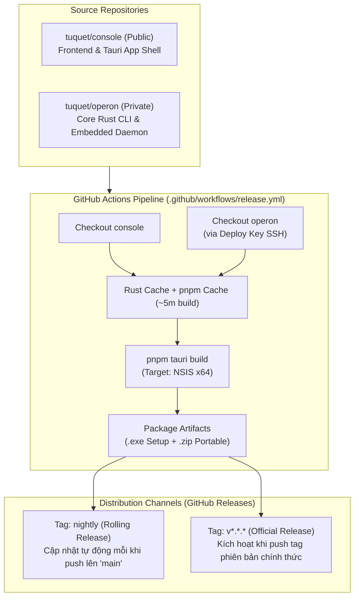

# Quy Trình Phát Hành Tự Động (Automated Release Process) - Operon Workstation

Tài liệu này hướng dẫn chi tiết quy trình CI/CD tự động đóng gói, phát hành và kiểm thử bản **Operon Workstation** (Tauri v2 Desktop App trên Windows x64).

---

## 1. Tổng Quan Kiến Trúc (Architecture)



---

## 2. Các Kênh Phát Hành (Release Channels)

| Kênh | Điều Kiện Kích Hoạt | Mục Đích | URL Tải Trực Tiếp |
| :-- | :-- | :-- | :-- |
| **Nightly (Rolling)** | Mỗi khi có commit mới được push hoặc merge vào nhánh `main` | Dành cho Tester, QA, Product Manager kiểm thử tính năng và sửa lỗi tức thì | [GitHub Releases Nightly](https://github.com/tuquet/console/releases/tag/nightly) |
| **Official Version** | Khi push git tag (ví dụ: `git tag v5.8.1 && git spush origin v5.8.1`) hoặc kích hoạt thủ công qua `workflow_dispatch` | Dành cho người dùng cuối (End-users) và production | [GitHub Releases Latest](https://github.com/tuquet/console/releases/latest) |

---

## 3. Hướng Dẫn Dành Cho Tester & QA

Tester **không cần cài đặt** bất kỳ công cụ lập trình nào (Node.js, Rust, Git, v.v.).

### ⚡ Cài đặt nhanh nhất (1 dòng lệnh PowerShell)

Mở cửa sổ Windows PowerShell (hoặc Terminal) và chạy lệnh:

```powershell
irm https://raw.githubusercontent.com/tuquet/console/main/scripts/install-nightly.ps1 | iex
```

_Lệnh trên sẽ tự động tải bản build mới nhất về thư mục `%TEMP%` và kích hoạt bộ cài._

### 📥 Tải trực tiếp bằng trình duyệt

- **Bộ cài Setup (.exe):** [Operon-Workstation-Setup.exe](https://github.com/tuquet/console/releases/download/nightly/Operon-Workstation-Setup.exe)  
  _(Cài đặt ở chế độ `currentUser`, không yêu cầu quyền Quản trị viên - Administrator UAC)._
- **Bản Portable (.zip):** [Operon-Workstation-Portable.zip](https://github.com/tuquet/console/releases/download/nightly/Operon-Workstation-Portable.zip)  
  _(Chỉ cần giải nén và chạy ngay `Operon Workstation.exe`)._

---

## 4. Các Tính Năng Hỗ Trợ Test Tích Hợp Sẵn

Bản build release đã được cấu hình sẵn các công cụ phục vụ chẩn đoán lỗi:

1. **Mở DevTools / Console bất cứ lúc nào:**
   - Bấm phím **`F12`** hoặc **`Ctrl + Shift + I`** trên bàn phím.
   - Hoặc click **Chuột phải** $\rightarrow$ chọn **Inspect Element (Kiểm tra)**.

2. **File Log kiên cố (Persistent File Logging):**
   - Toàn bộ hoạt động khởi động, lỗi unhandled exception, `console.error`, và trạng thái của Daemon API background đều được ghi tự động vào file:
     ```plaintext
     %USERPROFILE%\.operon\logs\workstation.log
     ```
     _(Ví dụ: `C:\Users\<Tên_User>\.operon\logs\workstation.log`)_

3. **Chế độ Local Operator (Không bắt buộc đăng nhập):**
   - Khi mở app, người dùng vào thẳng chế độ **Local Operator** (`Automation > Overview`) kết nối với Daemon in-process (cổng `8765`).
   - Nếu dialog đăng nhập xuất hiện, bạn có thể đóng bất kỳ lúc nào bằng cách:
     - Bấm nút **`X`** ở góc trên bên phải.
     - Bấm phím **`Esc`**.
     - Click chuột ra ngoài vùng nền modal.
     - Bấm liên kết **"Dismiss / Continue as Local Operator"**.

---

## 5. Cấu Hình Hạ Tầng CI/CD & Bảo Mật (DevOps)

### 5.1 Dual-Repo Checkout

Dự án máy trạm phụ thuộc vào crate lõi `operon` nằm trong repo private `tuquet/operon` qua đường dẫn tương đối:

```toml
operon = { package = "operon", path = "../../../../operon/crates/cli" }
```

GitHub Actions workflow giải quyết việc này bằng cách checkout cả 2 repos song song:

- `tuquet/console` $\rightarrow$ thư mục `console/`
- `tuquet/operon` $\rightarrow$ thư mục `operon/` (sử dụng SSH Deploy Key `OPERON_DEPLOY_KEY`).

### 5.2 Danh mục Secrets trên GitHub

Các secrets cần thiết được lưu trữ tại `https://github.com/tuquet/console/settings/secrets/actions`:

- `OPERON_DEPLOY_KEY`: SSH private key (Read-only) của private repo `tuquet/operon`.
- `VITE_SUPABASE_URL`: Endpoint Supabase Cloud.
- `VITE_SUPABASE_ANON_KEY`: Supabase Anonymous Public Key.
- `TAURI_SIGNING_PRIVATE_KEY` & `TAURI_SIGNING_PRIVATE_KEY_PASSWORD`: Khóa ký số phục vụ tính năng tự động cập nhật (In-App Updater).

### 5.3 Tối ưu hóa thời gian build (Build Speed Optimization)

Pipeline áp dụng các kỹ thuật:

- **Rust Cache (`Swatinem/rust-cache@v2`):** Cache toàn bộ crates biên dịch và target artifacts.
- **pnpm Cache:** Lưu cache store của pnpm theo `pnpm-lock.yaml`.
- **Target NSIS Only:** Bỏ qua bước đóng gói WiX MSI nặng nề, chỉ đóng gói NSIS installer giúp rút ngắn thời gian build xuống còn **~5-7 phút**.
