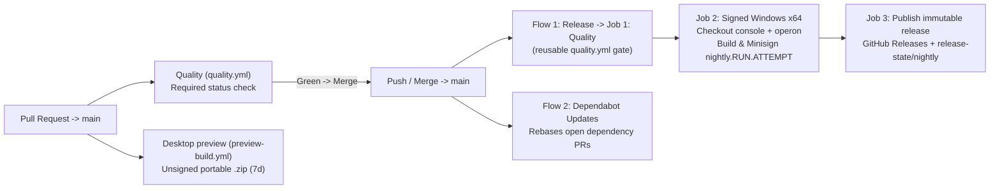
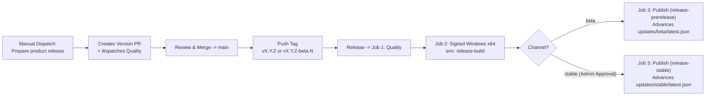
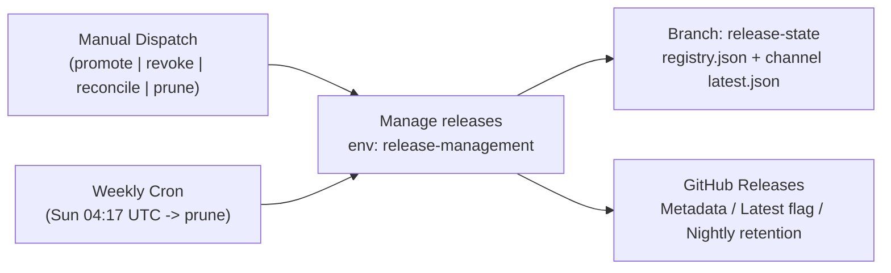

# Release lifecycle & CI/CD

GitHub Releases stores immutable binaries; the `release-state` branch stores the release registry, audit log, and channel `latest.json` feeds.

## Sources of truth

- `release/version.json`: product version (`pnpm release:version 5.8.1` syncs root, shell, Tauri, and Cargo manifests).
- `subsystem.json`: pinned `tuquet/operon` commit.
- `release/config.json`: repo, platforms, Rust toolchain, retention.
- `release-state/registry.json`: published tags, hashes, status (`active` / `revoked` / `archived`), channel pointers, audit history.

## CI/CD workflows

`.github/workflows/` defines 5 workflows (plus GitHub's dynamic `Dependabot Updates` rebase workflow):

| Event | Workflows | Result |
| --- | --- | --- |
| Pull request -> `main` | `quality.yml` + `preview-build.yml` | Required `Frontend quality` check + unsigned portable `.zip` (7d) for in-repo PRs |
| Merge / push -> `main` | `release.yml` + `Dependabot Updates` | Single `Quality` gate -> signed `X.Y.Z-nightly.RUN.ATTEMPT` release + PR rebases |
| Push tag `vX.Y.Z-beta.N` | `release.yml` | Signed beta release (`release-prerelease`) |
| Push tag `vX.Y.Z` | `release.yml` | Signed stable release (`release-stable`, admin approval required) |
| Manual / Weekly cron | `release-prepare.yml` / `release-manage.yml` | Version PR creation; channel `promote`, `revoke`, `reconcile`, or Sunday `prune` |

### 1. PR & Post-Merge (`main`) Flow



### 2. Beta & Stable Release Flow



### 3. Release Governance Flow (`release-manage.yml`)



## Cutting a beta or stable release

1. Run **Prepare product release** (`release-prepare.yml`) with `5.8.1` or `5.9.0-beta.1`, then merge the generated PR once green.
2. Tag the merged `main` commit (must match `release/version.json`; never re-tag an existing version):
   ```sh
   git fetch origin main && git tag v5.8.1 origin/main && git spush origin v5.8.1
   ```
3. Approve `release-stable` in GitHub Actions for stable tags.

## Artifact contract & feeds

Every release publishes immutable assets verified by SHA-256 and Ed25519 Minisign (against Tauri's public key, with SemVer bound in trusted comments):

- `Operon-VERSION-windows-x86_64-setup.exe` + `.sig`
- `Operon-VERSION-windows-x86_64-portable.zip`
- `release-manifest.json`, `latest.json`, `checksums.sha256`

Channel feeds (`https://raw.githubusercontent.com/tuquet/console/release-state/updates/<channel>/latest.json`): `stable`, `beta`, `nightly`.

## Channel operations & repo bootstrap

- **Manage releases** (`release-manage.yml`):
  - `promote`: advance a channel to an existing tag (no downgrades; no prereleases on `stable`).
  - `revoke`: clear channel pointers and mark release revoked (requires `reason`; ship a higher patch to remediate installed clients).
  - `reconcile`: register an already-published GitHub release after a state-branch failure.
  - `prune`: keep $\ge 14$ nightlies and 30 days of builds; `stable`, `beta`, and active channel targets are never pruned.
- **One-time repo setup** (idempotent): `node scripts/release/configure-github.mjs --apply`
  - Required secrets: `OPERON_DEPLOY_KEY`, `TAURI_SIGNING_PRIVATE_KEY`, `TAURI_SIGNING_PRIVATE_KEY_PASSWORD`, `VITE_SUPABASE_URL`, `VITE_SUPABASE_ANON_KEY`.

## Local updater simulation

Test Minisign signing, feed serving (`http://127.0.0.1:4567/latest.json`), and signature verification locally without CI or production keys:

```sh
pnpm updater:simulate                                # Generate, serve, and self-verify in one run
pnpm updater:simulate --server-only --apply-config   # Patch tauri.conf.json temporarily & serve for pnpm dev:desktop (Ctrl+C restores)
```

Options: `--port <4567>`, `--version <5.9.0>`, `--apply-config`, `--server-only`, `--dry-run`.
