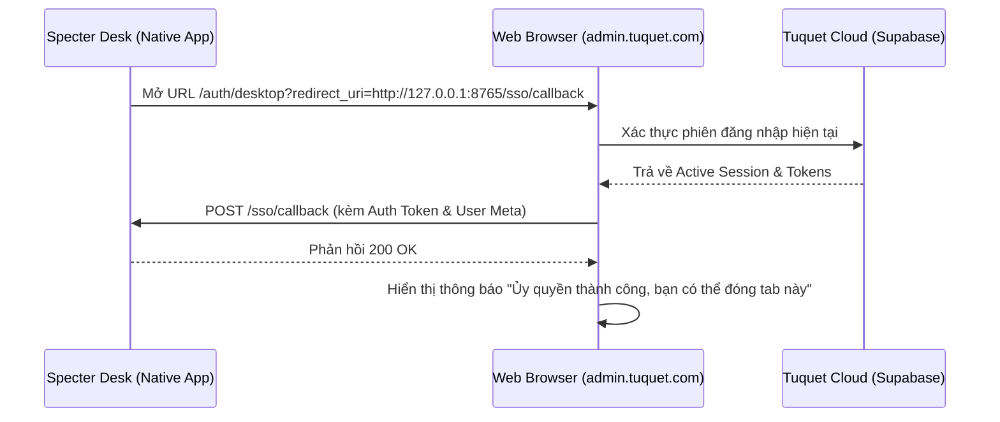

# Đặc Tả Route: Xác Thực & Tuyến Lõi (Authentication & Core Routes)

> **Module File:** [`apps/web-admin/src/router/routes/core.ts`](../../apps/web-admin/src/router/routes/core.ts)  
> **Layouts:** `AuthPageLayout` (cho các trang xác thực) và `BasicLayout` (cho khung quản trị)

---

## 1. Định Nghĩa Tuyến Đường Lõi (Core Route Definitions)

### 1.1. Tuyến Gốc & Hồ Sơ Cá Nhân (`Root` & `Profile`)

```typescript
{
  path: '/',
  name: 'Root',
  component: BasicLayout,
  redirect: preferences.app.defaultHomePath, // '/dashboard/analytics'
  children: [
    {
      path: 'profile',
      name: 'Profile',
      component: () => import('#/views/_core/profile/index.vue'),
      meta: {
        title: 'Hồ sơ người dùng',
        icon: 'lucide:user',
        hideInMenu: true,
      },
    },
  ],
}
```

- **Chức Năng:**
  - `/`: Tự động chuyển hướng tới trang chủ mặc định (`/dashboard/analytics`).
  - `/profile`: Cho phép người dùng cập nhật thông tin cá nhân (Họ tên, ảnh đại diện, email) lưu trực tiếp vào `public.profiles`.

---

### 1.2. Cụm Tuyến Xác Thực (`/auth/*`)

Sử dụng container giao diện chuyên dụng `AuthPageLayout` (`apps/web-admin/src/layouts/auth.vue`):

| Đường Dẫn (Path) | Tên Tuyến (Name) | Component Triển Khai | Mô Tả Nghiệp Vụ & Dòng Dữ Liệu |
| :-- | :-- | :-- | :-- |
| **`/auth/login`** | `Login` | [`login.vue`](../../apps/web-admin/src/views/_core/authentication/login.vue) | Đăng nhập bằng Email/Password hoặc Đăng nhập qua GitHub OAuth. |
| **`/auth/register`** | `Register` | [`register.vue`](../../apps/web-admin/src/views/_core/authentication/register.vue) | Đăng ký tài khoản quản trị mới, ghi nhận user vào Supabase Auth. |
| **`/auth/forget-password`** | `ForgetPassword` | [`forget-password.vue`](../../apps/web-admin/src/views/_core/authentication/forget-password.vue) | Gửi email khôi phục mật khẩu thông qua Supabase Auth Service. |
| **`/auth/reset-password`** | `ResetPassword` | [`reset-password.vue`](../../apps/web-admin/src/views/_core/authentication/reset-password.vue) | Nhận token khôi phục và thiết lập mật khẩu mới. |
| **`/auth/callback`** | `AuthCallback` | [`callback.vue`](../../apps/web-admin/src/views/_core/authentication/callback.vue) | Điểm tiếp nhận chuyển hướng (redirect URI) từ GitHub OAuth, bóc tách `access_token` và thiết lập phiên làm việc. |
| **`/auth/desktop`** | `DesktopBridge` | [`desktop-bridge.vue`](../../apps/web-admin/src/views/_core/authentication/desktop-bridge.vue) | Cổng ủy quyền máy trạm (Specter Desk Authorization), đẩy phiên đăng nhập về cổng loopback `http://127.0.0.1:8765/sso/callback`. |

---

### 1.3. Tuyến Bắt Lỗi Toàn Cục (`FallbackNotFound`)

```typescript
{
  path: '/:path(.*)*',
  name: 'FallbackNotFound',
  component: () => import('#/views/_core/fallback/not-found.vue'),
  meta: {
    title: '404',
    hideInMenu: true,
    hideInTab: true,
    hideInBreadcrumb: true,
  },
}
```

- Bắt toàn bộ các URL không tồn tại và chuyển hướng người dùng về trang thông báo 404 thân thiện, có nút quay về trang tổng quan.

---

## 2. Dòng Dữ Liệu Desktop SSO Bridge (`/auth/desktop`)



- **Quy tắc an toàn PNA:** Trình duyệt sẽ gửi lệnh xác thực cục bộ không làm rò rỉ credential ra ngoài domain máy trạm.
