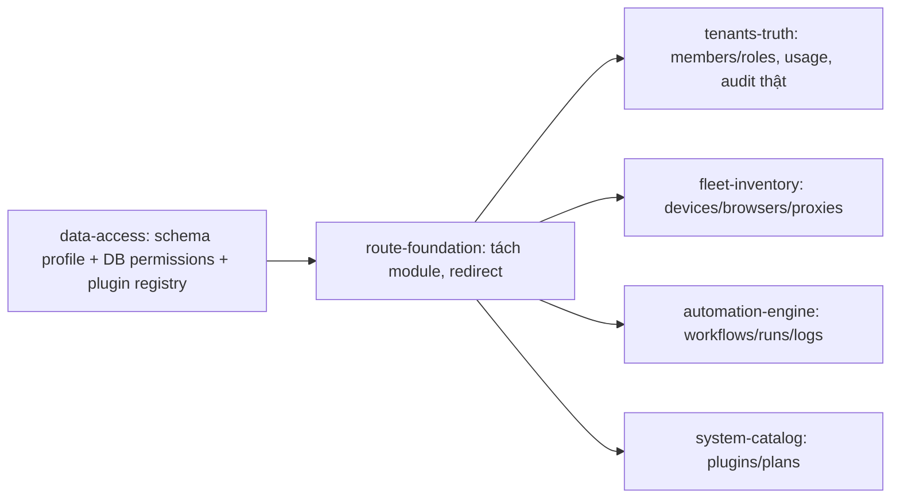

# Tuquet Admin Routing Architecture (v2 — Grounded in `cloud/supabase`)

> **Mã tài liệu:** `RFC-2026-ADMIN-ROUTES-V2` (thay thế V1)  
> **Áp dụng cho:** `tuquet/admin` (`apps/web-admin`)  
> **Nguồn sự thật (đã đối soát trực tiếp):** `tuquet/cloud/supabase/migrations/*.sql`, `supabase/plugins/*/install.sql`, `plugin.json`, `config.toml`  
> **Trạng thái:** **ACCEPTED & IMPLEMENTED** (100% 7/7 Modules đã nghiệm thu)  
> **Tài liệu đặc tả từng route:** [`docs/routes/README.md`](routes/README.md) | **Quyết định kiến trúc:** [`ADR-001`](decisions/0001-admin-routing-v2.md), [`ADR-002`](decisions/0002-superadmin-platform-governance.md)

---

## 1. Vì sao cần V2

V1 được viết dựa trên giả định, không đối chiếu schema thật. Khi đọc code `cloud/supabase` và `apps/web-admin/src/api`, phát hiện:

### 1.1. Sự thật về backend (khác với V1)

| # | Sự thật trong `cloud/supabase` | Hệ quả cho routing |
| :-- | :-- | :-- |
| B1 | **Không có sẵn Platform Super-Admin bypass.** RLS `public.tenants` mặc định chỉ trả về tenant mà user là thành viên (`get_user_tenant_ids()`). Đã giải quyết qua ADR-002 (`public.is_platform_admin()`). | Với user thông thường: multi-tenant member console. Với Superadmin: bypass RLS để giám sát toàn bộ nền tảng xuyên tenant (ADR-002). |
| B2 | `public.audit_logs.tenant_id NOT NULL`, RLS theo `has_tenant_permission(tenant_id, 'audit:read')`. | Với user thường: audit log thuộc về **từng tenant** (`/tenants/:id?tab=audit`). Với Superadmin: xem audit log toàn hệ thống qua `/system/audit-logs` (ADR-002). |
| B3 | Plugin registry thực tế: `core-iam`(public), `runners`(runners), `automa`(automa), `storage`(media), `subscriptions`(billing), `webhooks`(events). `automa` phụ thuộc `runners`. | Mỗi nhóm menu phải gắn với **plugin id** và ẩn khi plugin chưa `installed`. |
| B4 | PostgREST expose `runners, automa, media, billing, events` nhưng **bảng ngoài `public` chỉ truy cập được qua header `Accept-Profile` / `Content-Profile`**. `extra_search_path` không làm bảng addressable qua URL. | `supabaseRequest()` hiện **không hỗ trợ schema** → mọi call tới `runners.*`, `billing.*`, `automa.*` đều hỏng. |
| B5 | JWT hook `custom_access_token_hook` **cắt permissions ở 25** và chỉ cho **primary tenant**. Owner có 36 quyền (15 core + 7 runners + 6 automa + 3 subscriptions + 2 webhooks + 3 media). | **Không được** suy quyền giao diện từ JWT. Phải truy vấn DB (xem §4). |
| B6 | RLS `SELECT` của `runners.*`, `automa.*` chỉ kiểm tra `is_tenant_member()`, không kiểm tra `*:read`. | Permission `*:read` chỉ là **gợi ý UX** (ẩn menu), không phải lớp bảo mật. Bảo mật nằm ở RLS. |
| B7 | Gói cước thật nằm ở `billing.subscriptions` (1 dòng/tenant, có thể không tồn tại → backend coi là `free`, xem `check_tenant_quota`). | Không được đọc plan từ `tenants.metadata.plan`. |
| B8 | `automa.execution_logs`, `automa.campaign_runs` **không nằm trong** publication `supabase_realtime` (chỉ có `inbox.otps`, `inbox.emails`). | "Real-time log streaming" của V1 không khả thi nếu không thêm migration → mặc định **polling**. |
| B9 | Bảng `automa.campaign_runs` là **lần chạy**, không có bảng "campaign" định nghĩa. Có thêm `automa.schedules` mà V1 bỏ sót. | Route nên là `/automation/runs`, không phải `/automation/campaigns`. |
| B10 | **Không có bảng API key** ở bất kỳ schema nào. Credential headless thật là `runners.devices.device_token_hash` qua RPC `enroll_device`. | Tab "API Keys" hiện tại không có backend. |

### 1.2. Nợ kỹ thuật trong admin hiện tại (vi phạm AGENTS.md §5 — No Mock Data)

| File | Vấn đề |
| :-- | :-- |
| [`fleet.ts`](../apps/web-admin/src/api/core/fleet.ts) | Gọi `/rest/v1/devices` không có `Accept-Profile: runners` → lỗi → rơi về `localStorage` / `getInitialFallbackNodes()` (dữ liệu giả). |
| [`workspace-detail.ts`](../apps/web-admin/src/api/core/workspace-detail.ts) | Gọi `/rest/v1/machines` (bảng không tồn tại) → fallback `1`; `used_storage_mb` hardcode `1240/480/120`; quota hardcode thay vì `billing.plans`. |
| `workspace-detail.ts` `inviteWorkspaceMemberApi` | Gửi `role` (text) + `token`, nhưng bảng cần `role_id UUID`, `token_hash`, `invited_by NOT NULL` → **luôn thất bại**, lỗi bị nuốt bằng `console.warn`. |
| `workspace-detail.ts` `updateWorkspaceMemberApi` | Không ghi `member_roles`; dùng role `developer` không tồn tại trong `public.roles`. |
| `workspace-detail.ts` API keys | Lưu khóa vào `tenants.metadata.api_keys` — không backend nào xác thực khóa này. |
| [`analytics.ts`](../apps/web-admin/src/api/core/analytics.ts), `tenant.ts` | Plan đọc từ `metadata.plan`, mặc định `'pro'`. |
| [`user.ts`](../apps/web-admin/src/api/core/user.ts), [`auth.ts`](../apps/web-admin/src/api/core/auth.ts) | `roles: ['super','admin']` và access codes hardcode. |

> [!IMPORTANT] Đổi URL mà không sửa tầng dữ liệu chỉ là "sơn lại" — các trang mới (`/fleet/browsers`, `/automation/*`, `/system/plans`) sẽ hỏng ngay vì lỗi B4. **Tầng dữ liệu là điều kiện tiên quyết của routing.**

---

## 2. Nguyên tắc V2

1. **Route = Plugin boundary.** Mỗi nhóm menu ánh xạ đúng 1 plugin id trong `public.system_plugins`. Plugin không `installed` → nhóm menu không được đăng ký.
2. **Tenant-scoped, cross-tenant list.** Mọi bảng nghiệp vụ đều có `tenant_id`. Trang danh sách hiển thị hợp các tenant user thuộc về (đúng như RLS trả về), có cột Tenant và bộ lọc `?tenant=<uuid>` trên URL. Không thêm tenant switcher vào header (tuân thủ AGENTS §1.2).
3. **Platform catalog ≠ tenant data.** `/system` chỉ chứa dữ liệu không thuộc tenant: `system_plugins`, `billing.plans`.
4. **Permission từ DB, không từ JWT.** (B5)
5. **URL dùng danh từ của DB**: `tenants`, `devices`, `browsers`, `proxies`, `workflows`, `runs`, `plugins`, `plans`. Nhãn UI có thể là "Workspace".
6. **Tối đa 5 nhóm sidebar**, read-first. CRUD chỉ khi đã có trong code hiện tại (Tenants, Members).

---

## 3. Bản đồ định tuyến

```text
/                                   BasicLayout
├── /dashboard                      [core-iam]        lucide:layout-dashboard
│   └── /dashboard/analytics
├── /tenants                        [core-iam]        lucide:building-2     label: Workspaces
│   ├── /tenants                    list (Dual View)
│   └── /tenants/:id                detail, tab qua ?tab=
│         tabs: overview | members | usage | audit
├── /fleet                          [runners]         lucide:cpu
│   ├── /fleet/devices              ?tenant=&status=
│   ├── /fleet/browsers             ?tenant=&status=
│   └── /fleet/proxies              ?tenant=&status=
├── /automation                     [automa]          lucide:workflow
│   ├── /automation/workflows       ?tenant=&status=
│   ├── /automation/runs            ?tenant=&status=&workflow=
│   └── /automation/runs/:id        run detail + execution logs (polling)
└── /system                         [core-iam]        lucide:shield-check
    ├── /system/plugins             public.system_plugins
    ├── /system/plans               [subscriptions]   billing.plans
    ├── /system/users               [core-iam]        authority: superadmin (public.profiles)
    ├── /system/audit-logs          [core-iam]        authority: superadmin (public.audit_logs)
    ├── /system/subscriptions       [subscriptions]   authority: superadmin (billing.subscriptions)
    └── /system/roles               [core-iam]        authority: superadmin (public.roles, permissions)

Core (giữ nguyên): /auth/login, /auth/register, /auth/forget-password,
/auth/reset-password, /auth/callback, /auth/desktop, /profile
```

**Thay đổi so với V1:**

| V1 | V2 | Lý do |
| :-- | :-- | :-- |
| `/system/audit-logs` | `/tenants/:id?tab=audit` (User) & `/system/audit-logs` (Superadmin) | B2 & ADR-002: Tenant audit cho user, global audit cho superadmin |
| `/automation/campaigns[/:id]` | `/automation/runs[/:id]` | B9 — bảng là `campaign_runs`; nhãn UI "Campaign Runs" |
| Tab "API Keys" | Loại bỏ (chờ quyết định D4) | B10 — không có backend |
| Tab "Members & RBAC" | Tab `members` (gán role thật qua `member_roles`) | Sửa lỗi ghi role |
| "Quotas" từ hằng số | Tab `usage` từ `billing.subscriptions` + `plans` + `usage_meters` | B7, No Mock |
| Real-time streaming | Polling 3s khi run ở trạng thái `pending/queued/running` | B8 |
| `/tenants/:id` lồng route con theo tab | Một route, tab qua query `?tab=` | KISS — không nhân route |

---

## 4. Ma trận route — permission — nguồn dữ liệu

Permission id lấy **nguyên văn** từ `public.permissions` (seed trong migrations/plugins).

| Route | Name | Plugin | Permission (UX gate) | Schema.Table (header) |
| :-- | :-- | :-- | :-- | :-- |
| `/dashboard/analytics` | `Analytics` | core-iam | — (authenticated) | `public.tenants`, `public.system_plugins`, `billing.subscriptions` |
| `/tenants` | `Tenants` | core-iam | `tenants:read` | `public.tenants` |
| `/tenants/:id` | `TenantDetail` | core-iam | `tenants:read` | `public.tenants`, `tenant_members`, `member_roles`, `roles` |
| ↳ `?tab=usage` | — | subscriptions | `quota:read` | `billing.subscriptions`, `billing.plans`, `billing.usage_meters` |
| ↳ `?tab=audit` | — | core-iam | `audit:read` | `public.audit_logs` |
| `/fleet/devices` | `FleetDevices` | runners | `runners:devices:read` | `runners.devices` (`Accept-Profile: runners`) |
| `/fleet/browsers` | `FleetBrowsers` | runners | `runners:browsers:read` | `runners.browsers` |
| `/fleet/proxies` | `FleetProxies` | runners | `runners:proxies:read` | `runners.proxies` |
| `/automation/workflows` | `AutomationWorkflows` | automa | `automa:workflows:read` | `automa.workflows` (RLS đã lọc `deleted_at IS NULL`) |
| `/automation/runs` | `AutomationRuns` | automa | `automa:campaigns:read` | `automa.campaign_runs` |
| `/automation/runs/:id` | `AutomationRunDetail` | automa | `automa:logs:read` | `automa.campaign_runs`, `automa.execution_logs` |
| `/system/plugins` | `SystemPlugins` | core-iam | `plugins:read` | `public.system_plugins` |
| `/system/plans` | `SystemPlans` | subscriptions | `subscriptions:read` | `billing.plans` |
| `/system/users` | `SystemUsers` | core-iam | `superadmin` | `public.profiles` |
| `/system/audit-logs` | `SystemAuditLogs` | core-iam | `superadmin` | `public.audit_logs` |
| `/system/subscriptions` | `SystemSubscriptions` | subscriptions | `superadmin` | `billing.subscriptions` (`Accept-Profile: billing`) |
| `/system/roles` | `SystemRoles` | core-iam | `superadmin` | `public.roles`, `permissions` |

**Tính quyền hiệu lực (không cần sửa backend)** — một request PostgREST với RLS hiện có:

```http
GET /rest/v1/tenant_members?user_id=eq.<uid>&status=eq.active
    &select=tenant_id,member_roles(roles(name,role_permissions(permission_id)))
```

→ Hợp (union) tất cả `permission_id` = danh sách quyền cho menu. Đồng thời giữ map `tenant_id → permissions` để ẩn/hiện tab trong `/tenants/:id`.

**Danh sách plugin đã cài:** `GET /rest/v1/system_plugins?status=eq.installed&select=id` (RLS cho phép mọi authenticated).

---

## 5. Hợp đồng tầng dữ liệu (điều kiện tiên quyết)

Mở rộng hàm dùng chung duy nhất `supabaseRequest()` (AGENTS §8) — không tạo client mới:

```ts
export interface SupabaseRequestOptions extends RequestInit {
  preferRepresentation?: boolean;
  /** PostgREST schema profile. Default: 'public'. */
  schema?: 'automa' | 'billing' | 'events' | 'media' | 'public' | 'runners';
}
// GET/HEAD  -> headers['Accept-Profile']  = schema
// khác      -> headers['Content-Profile'] = schema
```

Quy tắc:

- Lỗi PostgREST phải nổi lên UI (toast + empty/error state). **Cấm** fallback sang `localStorage`, hằng số hoặc dữ liệu mẫu.
- Bảng rỗng → empty state có hướng dẫn (ví dụ: "Chưa có Runner — dùng `specter enroll`").

---

## 6. Tương thích ngược

| Đường dẫn cũ               | Đích mới               |
| :------------------------- | :--------------------- |
| `/dashboard/workspace`     | `/tenants`             |
| `/dashboard/workspace/:id` | `/tenants/:id`         |
| `/dashboard/fleet`         | `/fleet/devices`       |
| `/dashboard`               | `/dashboard/analytics` |

Cập nhật đồng bộ: `preferences.ts → defaultHomePath`, `user.ts → homePath` (`/dashboard/analytics`), và 5 lời gọi `router.push('/dashboard/workspace…')` trong `profile/index.vue`, `workspace/index.vue`, `workspace/detail.vue`.

---

## 7. Quyết định đã chốt (2026-10-13)

| ID | Quyết định |
| :-- | :-- |
| D1 | **Hai chế độ truy cập.** Superadmin thấy toàn bộ dữ liệu mọi tenant. User thường áp dụng chuẩn RLS hiện hành (chỉ tenant mình là thành viên, quyền theo `role_permissions`). Xem §7.1. |
| D2 | Quyền hiệu lực tính từ DB bằng query PostgREST ở §4 — không thêm RPC. |
| D3 | Log run dùng polling 3s. |
| D4 | Ẩn tab API Keys khỏi giao diện cho tới khi `cloud` có bảng/API key thật; khi đó mở lại theo backend mới. |
| D5 | `automa.schedules`, `media.assets`, `events.*` chưa vào menu. |

### 7.1. Superadmin (cần thay đổi ở repo `cloud`)

Backend hiện **không có** khái niệm superadmin (cột `auth.users.is_super_admin` của GoTrue không vào JWT và không được RLS dùng). Đề xuất tối giản:

- **Nguồn danh tính:** `auth.users.raw_app_meta_data.platform_role = 'superadmin'`. `app_metadata` chỉ service role ghi được → user không tự nâng quyền. Hook `custom_access_token_hook` dùng `jsonb_set` nên giữ nguyên key này trong JWT.
- **Hàm kiểm tra O(1):** `public.is_platform_admin()` = `COALESCE(auth.jwt() -> 'app_metadata' ->> 'platform_role', '') = 'superadmin'`.
- **RLS bổ sung (permissive, cộng thêm, không sửa policy cũ):** mỗi bảng nghiệp vụ thêm 1 policy `FOR SELECT TO authenticated USING (public.is_platform_admin())` — `public.tenants`, `tenant_members`, `member_roles`, `roles`, `tenant_invitations`, `audit_logs`, `runners.*`, `automa.*`, `billing.*` (gồm `plans` không active), `media.assets`, `events.*`.
- **Phía admin:** đọc `platform_role` từ JWT (đã ký, tin cậy được). Superadmin nhận toàn bộ `public.permissions` làm quyền UX; vẫn áp dụng gate theo plugin (schema chưa cài thì không có dữ liệu).
- **Hạn chế đã chấp nhận:** thu hồi quyền superadmin có hiệu lực khi token refresh (mặc định ≤ 1h).

Cho tới khi migration `cloud` được merge, admin vẫn chạy đúng ở chế độ user thường (superadmin chỉ thấy các tenant mình là thành viên).

**Lỗi phát hiện ở repo `cloud` (báo cáo, không sửa từ repo này):**

- `supabase/seed.sql` seed gói cước vào `public.tenant_subscriptions` (không tồn tại) thay vì `billing.subscriptions` → dữ liệu seed không có subscription.
- Quyền bị trùng nghĩa: core `billing:read/manage` vs plugin `subscriptions:read/manage`.
- Cap 25 permission trong JWT đã nhỏ hơn số quyền của owner (36).

---

## 8. Thứ tự triển khai (đầu vào cho capability map)



Chi tiết module, phạm vi và tiêu chí nghiệm thu: [`docs/specs/capability-map.md`](specs/capability-map.md).
