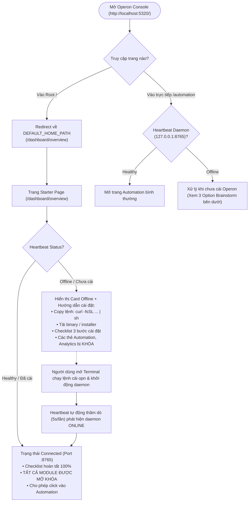
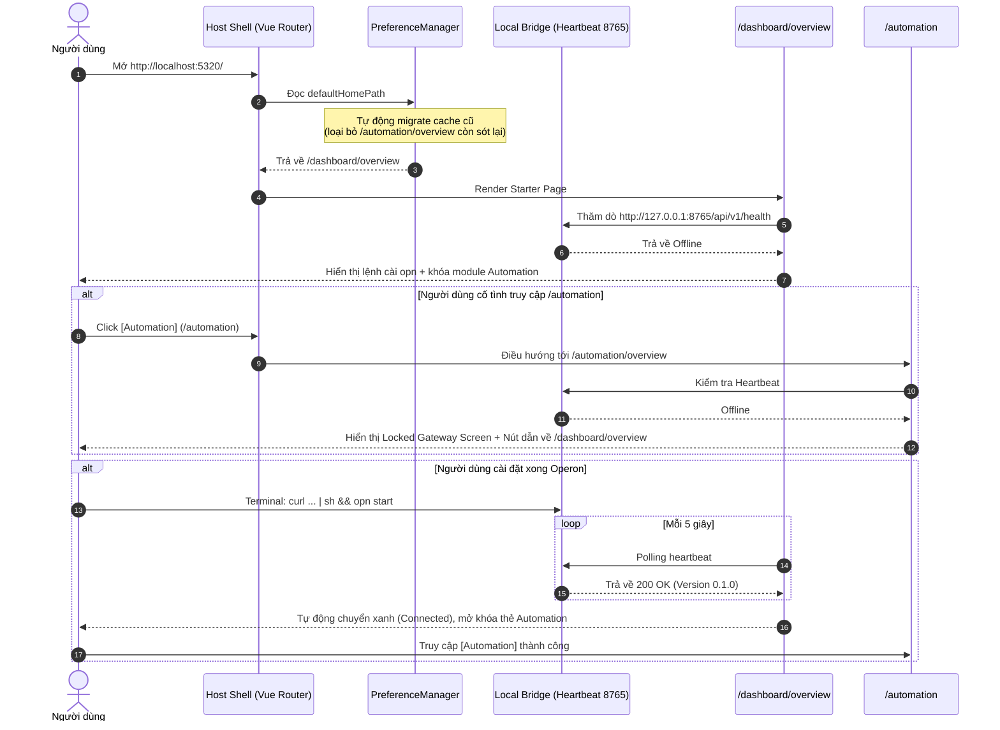

# Operon Onboarding & Module Gate Flow (Brainstorming)

> **Mục tiêu**: Thiết kế luồng trải nghiệm người dùng (UX Flow) và kiến trúc kiểm soát (Gate Architecture) khi truy cập ứng dụng Console Web/Desktop:
> 1. Điểm khởi đầu chuẩn xác: Mặc định luôn là **`http://localhost:5320/dashboard/overview`** (Starter Page).
> 2. Quản lý phụ thuộc: Module **Automation** (và các module cục bộ) bắt buộc phải cài đặt và kích hoạt dịch vụ **Operon Daemon** (`127.0.0.1:8765`).

---

## 1. Phân tích nguyên nhân: Actual vs Expected

```text
Actual  : http://localhost:5320/automation/overview
Expected: http://localhost:5320/dashboard/overview
```

### Tại sao lại bị điều hướng vào `/automation/overview`?
1. **Bộ nhớ đệm trình duyệt (`localStorage`)**:
   - `PreferenceManager` trong `@operon/preferences` có cơ chế lưu cache cấu hình người dùng vào `localStorage` (`preferences.app.defaultHomePath`).
   - Ở các phiên bản trước khi refactor, Desktop mode được đặt mặc định là `/automation/overview`. Trình duyệt đã lưu giá trị này vào cache từ các lần chạy trước.
   - Khi khởi động, `mergeWithArrayOverride` ưu tiên giá trị trong `cachedPreferences` hơn `initialPreferences`.
2. **Cấu hình gốc của package `@operon/preferences`**:
   - Trong `packages/@core/preferences/src/config.ts`, `defaultHomePath` đang là `'/dashboard'` thay vì `'/dashboard/overview'`.
3. **Giải pháp xử lý triệt để (Auto Cache Migration)**:
   - Thêm bộ lọc dọn dẹp cache cũ trong `PreferenceManager.initPreferences`: Nếu `cachedApp.defaultHomePath` là `/automation/overview` hoặc `/dashboard/analytics`, tự động xóa để fallback về `DEFAULT_HOME_PATH = '/dashboard/overview'`.

---

## 2. Luồng trải nghiệm tổng thể (End-to-End User Journey)



---

## 3. Brainstorm: Xử lý khi người dùng vào `/automation` khi chưa cài Operon

Khi người dùng click vào menu `[Automation]` trên sidebar hoặc gõ trực tiếp `http://localhost:5320/automation` trong lúc daemon chưa bật:

### Option A — Strict Route Guard (Chặn & Điều hướng về Starter Page)
- **Hành vi**: Router Guard kiểm tra trạng thái heartbeat của local bridge. Nếu `!isHealthy` và route thuộc nhóm yêu cầu daemon (`automation`, `playground`), guard chặn chuyển trang và đưa người dùng về `/dashboard/overview`, đồng thời hiện toast thông báo: *"Module Automation yêu cầu cài đặt và khởi động dịch vụ Operon"*.
- **Ưu điểm**: Tập trung trải nghiệm vào một trang Onboarding duy nhất (`/dashboard/overview`), không làm loãng giao diện.
- **Nhược điểm**: Người dùng gõ URL có thể cảm thấy bất ngờ vì bị đẩy về trang chủ.

### Option B — In-Page Gateway / Unlock Screen (Khóa tại chỗ)
- **Hành vi**: Vẫn cho phép vào `/automation`, nhưng view `/automation/overview` sẽ hiển thị một màn hình Empty State / Gate đẹp mắt:
  - Icon ổ khóa lớn + Huy hiệu `Operon Daemon Required`.
  - Hộp lệnh cài đặt nhanh + nút Copy & Retry.
  - Nút bấm *"Xem hướng dẫn chi tiết tại Dashboard Overview"*.
- **Ưu điểm**: Trực quan, người dùng biết chính xác mình đang ở module Automation và lý do tại sao nó chưa hoạt động.
- **Nhược điểm**: Mỗi micro-app cần có màn hình gateway tương tự.

### Option C — Hybrid Smart Gate (Đề xuất tối ưu)
- **Hành vi**:
  1. **Trên Sidebar / Menu**: Khi daemon offline, menu `Automation` hiển thị một badge nhỏ màu cam `Required` hoặc icon ổ khóa mờ.
  2. **Khi click vào Menu Sidebar**: Nếu offline, popup nhẹ hoặc toast gợi ý mở Starter Page để cài đặt.
  3. **Nếu truy cập trực tiếp URL `/automation`**: Trang Automation hiển thị Card cảnh báo yêu cầu daemon (như giao diện hiện tại của `apps/automation/src/views/index.vue`), với nút *"Quay về trang Tổng quan cài đặt"*.
  4. **Starter Page `/dashboard/overview`**: Giữ vai trò là Trung tâm Onboarding SSOT cho toàn bộ hệ thống.

---

## 4. Kế hoạch kỹ thuật triển khai



---

## 5. Câu hỏi định hướng Brainstorm dành cho bạn

1. **Về luồng điều hướng khi click `[Automation]` lúc offline**:
   - Bạn muốn áp dụng **Option A** (tự động đưa về `/dashboard/overview` và báo toast), **Option B** (giữ ở `/automation` và hiện màn hình khóa yêu cầu cài đặt), hay **Option C** (Hybrid kết hợp cả hai)?
2. **Về danh mục Menu Sidebar**:
   - Menu `Dashboard` hiện đang gộp trực tiếp về `/dashboard/overview`. Bạn có muốn mở rộng Dashboard thành 2 mục con trong menu: `Overview` (Starter Page) và `Analytics` (Chỉ số) không?
