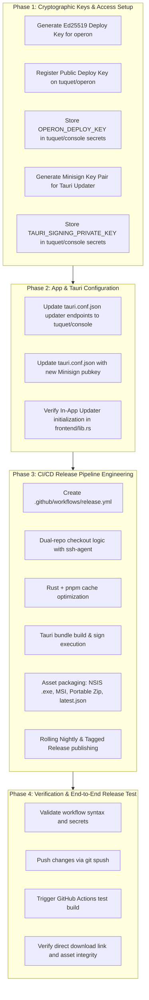

# Implementation Plan: Automated Release & Distribution Pipeline for Operon Workstation

Based on the approved specification [SPEC-automated-release-and-distribution.md](../SPEC-automated-release-and-distribution.md) and user decisions:

1. **Access Method:** Deploy Key (Read-only) for `tuquet/operon` stored as `OPERON_DEPLOY_KEY` in `tuquet/console`.
2. **Release Triggers:** Option 1 (Nightly Rolling on `main` + Semantic Releases on `v*` tags + manual `workflow_dispatch`).
3. **In-App Auto-Updater:** Enabled immediately with Minisign signing and `latest.json` published on GitHub Releases.

---

## 1. Dependency Graph & Vertical Slicing

---

## 2. Implementation Phases & Verification Checkpoints

### Checkpoint 1: Security & Secrets Verification

- `tuquet/operon` has a read-only deploy key configured.
- `tuquet/console` has secrets: `OPERON_DEPLOY_KEY`, `TAURI_SIGNING_PRIVATE_KEY`, `VITE_SUPABASE_URL`, `VITE_SUPABASE_ANON_KEY`.

### Checkpoint 2: Tauri Updater Config Verification

- `apps/workstation/src-tauri/tauri.conf.json` contains:
  - Correct endpoint `https://github.com/tuquet/console/releases/latest/download/latest.json`.
  - Matching Minisign public key.

### Checkpoint 3: CI Pipeline Syntax & Execution

- `.github/workflows/release.yml` passes lint/schema check.
- Runner successfully clones `operon` via SSH and resolves `../../../../operon/crates/cli`.

### Checkpoint 4: Distribution Release Gate

- Rolling pre-release `nightly` is live with downloadable `Operon-Workstation-Setup.exe`.
- In-app updater endpoint `latest.json` is served properly.

---

## 3. Risks & Mitigations

| Risk | Impact | Mitigation |
| --- | --- | --- |
| Windows runner build timeout (> 30 min) | Slow feedback loop | Use `Swatinem/rust-cache@v2` targeting both `workstation/src-tauri` and `operon` workspaces. |
| Private repo clone failure in CI | Pipeline abort | Use `webfactory/ssh-agent@v0.9.0` with strict known_hosts verification for github.com. |
| Tauri Updater signature mismatch | App fails to install updates | Generate clean Minisign key pair, store private key securely, and test signature generation. |
| NSIS installer elevation prompt | Poor tester UX | Enforce `"installMode": "currentUser"` in `tauri.conf.json`. |
