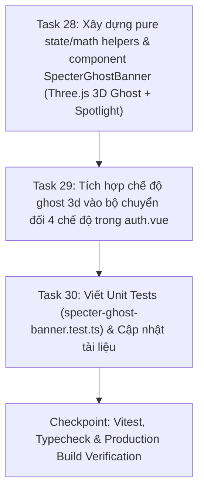

# Implementation Plan: Interactive 3D Specter Ghost Banner (`specter-3d-ghost-banner`)

## Overview

Triển khai bản đặc tả đã phê duyệt [`SPEC-specter-3d-ghost-banner.md`](../apps/web-admin/docs/specs/SPEC-specter-3d-ghost-banner.md): xây dựng mô hình **Con Ma 3D (`SpecterGhostBanner`)** bằng **WebGL / Three.js thời gian thực** lấy cảm hứng từ linh vật gốc [`specter-waving.svg`](../apps/web-admin/public/illustrations/specter-waving.svg), đồng bộ hiệu ứng ánh sáng `<Spotlight />` với [`spline-robot-banner.vue`](../apps/web-admin/src/components/common/spline-robot-banner.vue) và tích hợp vào bộ chuyển đổi 4 chế độ (`phone` · `robot 3d` · `ghost 3d` · `random`) tại [`auth.vue`](../apps/web-admin/src/layouts/auth.vue).

---

## Architecture Decisions

1. **Procedural 3D Ghost Mesh & Harmonic Cloth-Wave Vertex Displacement (`specter-ghost-banner.vue`):**
   - Tải động `three@0.174.0` qua ESM CDN (`esm.sh` / `jsdelivr` fallback) để giữ bundle chính của `web-admin` bằng `0 KB` khi người dùng không mở tab `ghost 3d`.
   - Thân ma 3D được tạo từ `SphereGeometry` / `LatheGeometry` mật độ lưới cao (`64 × 48` segments) với vật liệu **Matte Frosted Ceramic (`MeshPhysicalMaterial`)** có `roughness: 0.32`, `clearcoat: 0.25`, `sheen: 0.4` tạo hiệu ứng sứ mờ phản xạ ánh sáng viền (rim-light) sang trọng ở cả Dark mode (`#0a0a0a`) và Light mode (`#fafafa`).
   - Nửa dưới thân ma (tà áo) được biến dạng đỉnh (vertex displacement) trong mỗi frame theo hàm sóng hài đa tần $\Delta r(\theta, t) = A_1 \sin(5\theta + \omega_1 t) + A_2 \cos(3\theta - \omega_2 t)$ kết hợp `computeVertexNormals()` để tạo chuyển động tà áo bay phấp phới 3D mềm mại.
2. **Ba Đặc Trưng Nhận Diện Linh Vật Specter Gốc (`specter-waving.svg`):**
   - **Mắt bầu dục đen bóng + Ngôi sao 4 cánh (`4-Point Star Catchlight`):** Dựng cặp mắt 3D hơi cong ôm sát mặt trước, bên trên đính geometry ngôi sao 4 cánh trắng phát sáng (`MeshBasicMaterial`) và chấm phản quang phụ; toàn bộ cụm mắt dịch chuyển parallax theo hướng con trỏ chuột (eye-tracking).
   - **Đôi má ửng & miệng cười:** Hai khối elip dẹt màu hồng phấn/trung tính mờ (`opacity: 0.35`) hai bên má cùng khuôn miệng cười 3D.
   - **Cánh tay 3D vẫy chào (`Wave Interaction`):** Tay trái thả nhẹ theo nhịp thở, tay phải giơ cao vẫy chào liên tục; khi người dùng rê chuột lại gần hoặc click vào con ma, biến `waveBoost` được kích hoạt làm con ma nảy người vui vẻ và vẫy tay nhanh chào đón.
3. **Bộ Chuyển Đổi 4 Chế Độ Banner (`auth.vue`):**
   - Mở rộng `BannerMode = 'phone' | 'robot' | 'ghost' | 'random'` và `ActiveScene = 'phone' | 'robot' | 'ghost'`.
   - Khi ở chế độ `random`, chọn ngẫu nhiên 1 trong 3 cảnh (`phone`, `robot`, `ghost`) mỗi lần tải trang, và khi nhấn lại nút `random` sẽ xoay vòng sang cảnh tiếp theo ngay lập tức.

---

## Dependency Graph

---

## Task List

### Phase 1: 3D Specter Ghost Component

- [x] **Task 28:** Xây dựng [`apps/web-admin/src/components/common/specter-ghost-banner.vue`](../apps/web-admin/src/components/common/specter-ghost-banner.vue) với mô hình Three.js 3D Specter Ghost (thân sứ mờ, tà áo lượn sóng, mắt ngôi sao 4 cánh liếc theo chuột, tay vẫy chào khi hover/click, Spotlight SVG và dọn dẹp GPU đầy đủ).

### Phase 2: Auth Layout Integration & Unit Tests

- [x] **Task 29:** Cập nhật [`apps/web-admin/src/layouts/auth.vue`](../apps/web-admin/src/layouts/auth.vue) để bổ sung tuỳ chọn `ghost 3d` vào thanh chuyển đổi (`phone` · `robot 3d` · `ghost 3d` · `random`) và lưu trữ `localStorage`.
- [x] **Task 30:** Viết unit test [`apps/web-admin/src/components/common/__tests__/specter-ghost-banner.test.ts`](../apps/web-admin/src/components/common/__tests__/specter-ghost-banner.test.ts) kiểm tra toán học giảm chấn chuột, biến dạng sóng tà áo, vòng đời component và chuyển đổi 4 chế độ.

### Checkpoint: Complete Quality Gate

- [x] Tất cả unit tests (`vitest`), kiểm tra kiểu (`typecheck`) và bản dựng production (`build:admin`) kết thúc với 0 lỗi.

---

## Risks and Mitigations

| Risk | Impact | Mitigation |
| --- | --- | --- |
| Rò rỉ bộ nhớ WebGL khi người dùng bấm chuyển liên tục giữa `robot 3d` và `ghost 3d` | High | Hủy `requestAnimationFrame`, gọi `geometry.dispose()`, `material.dispose()`, `renderer.dispose()` và `renderer.forceContextLoss()` trong `onBeforeUnmount`. |
| Mất chi tiết khối trắng của con ma trên nền sáng (`#fafafa`) ở Light Mode | Medium | Sử dụng hệ thống 3 nguồn sáng (Key Light, Cool Rim Light, Warm Fill Light) + bóng đổ elip mềm dưới chân con ma để tách khối rõ ràng trên nền `#fafafa`. |

---

## Open Questions

- Không có câu hỏi mở.
