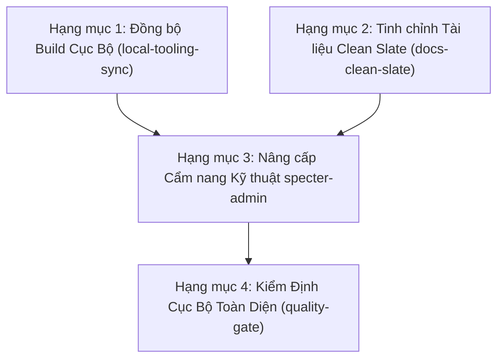

# Kế Hoạch Triển Khai: Nền Tảng Kỹ Thuật & Kiến Trúc Monorepo (Module `platform-foundation`)

## 1. Mục Tiêu & Phạm Vi (Objective & Scope)

Dựa trên bản đặc tả [`docs/specs/SPEC-platform-foundation.md`](../docs/specs/SPEC-platform-foundation.md), kế hoạch này chuẩn hóa toàn diện 3 hạng mục nền tảng:

1. **Hạng mục 1 — Đồng bộ hạ tầng Build Cục Bộ (`local-tooling-sync`):** Tích hợp script `scripts/build-local.sh`, lệnh `"build:local"` và PWA auto-update vào nhánh làm việc.
2. **Hạng mục 2 — Tinh chỉnh Tài liệu Pre-Release Clean Slate (`docs-clean-slate`):** Loại bỏ hoàn toàn các từ ngữ so sánh phiên bản cũ trong `docs/specs/` và `docs/routes/`.
3. **Hạng mục 3 — Nâng cấp Cẩm Nang Kỹ Thuật Chuẩn (`specter-admin` Runbook):** Hoàn thiện cẩm nang 8 trụ cột chuẩn mực, trực diện, không marketing fluff, phục vụ phân tích và sửa code nhanh nhất.

---

## 2. Thứ Tự Triển Khai & Đồ Thị Phụ Thuộc (Dependency Graph)

---

## 3. Quản Trị Rủi Ro & Biện Pháp Giảm Thiểu (Risks & Mitigations)

| Rủi Ro | Mức Độ | Biện Pháp Giảm Thiểu |
| :-- | :-- | :-- |
| **Tràn bộ nhớ Node khi build trên VPS** | Trung bình | `scripts/build-local.sh` đã thiết lập sẵn `NODE_OPTIONS="--max-old-space-size=4096"` và dọn cache `.turbo` nếu dung lượng disk > 85%. |
| **Xung đột kiểu dữ liệu hoặc linter** | Thấp | Chạy kiểm tra từng bước `check:type` và `oxlint` sau mỗi sửa đổi. |
| **Vi phạm Zero-Push Invariant** | Cao | Tuyệt đối không chạy `git push`. Mọi kiểm tra thực hiện trên Nginx cục bộ và Tailscale mesh (`100.68.217.61:80`). |

---

## 4. Các Điểm Kiểm Định Chất Lượng (Verification Checkpoints)

- **Checkpoint 1:** `scripts/build-local.sh` chạy thành công không lỗi, Nginx reload trả về HTTP 200 trên localhost và Tailscale.
- **Checkpoint 2:** 100% tài liệu `docs/` tuân thủ nguyên tắc Pre-Release Clean Slate.
- **Checkpoint 3:** File kỹ năng `/root/.gemini/config/plugins/specter/skills/specter-admin/SKILL.md` sở hữu đầy đủ 8 trụ cột kiến trúc chuẩn mực.
- **Checkpoint 4:** `pnpm run check:type` đạt 0 lỗi, `vitest` pass 100%, `oxfmt` & `eslint` đạt 0 errors.
