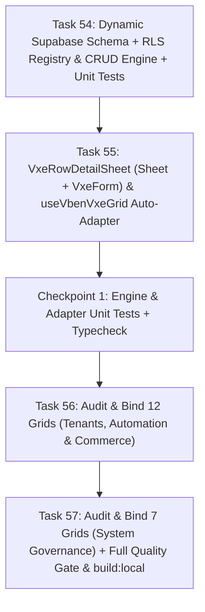

# Implementation Plan: Enterprise Dynamic Supabase Schema + RLS Kết Hợp `VxeGrid` & `VxeForm` Detail/CRUD Sheet (`SPEC-mobile-vxe-detail-sheet.md`)

## Overview

Triển khai kiến trúc **Enterprise Dynamic Schema-Driven & RLS-Aware CRUD Sheet (`SPEC-mobile-vxe-detail-sheet.md` v2.0)** kết hợp trực tiếp **Supabase Multi-Schema (`public`, `automa`, `runners`, `commerce`, `billing`) + Row-Level Security (RLS) + `useVbenVxeGrid` (`VxeTable`) + `VxeForm` (`Sheet`)**:

1. **Task 54 — Tầng Engine Động Supabase Schema & RLS (`src/api/core/supabase-schema-registry.ts`) + Unit Tests:**
   - Xây dựng `SUPABASE_TABLE_REGISTRY` định nghĩa siêu dữ liệu cột, kiểu dữ liệu, liên kết Enum (`@vben/constants` / `#/constants` qua `buildEnumFilterOptions`), và **Ma trận Chính sách RLS (`evaluateRowRlsPolicy`)** cho toàn bộ **18 bảng dữ liệu trên 5 schema** (`public.tenants`, `automa.workflows`, `automa.campaign_runs`, `runners.devices`, `runners.browsers`, `runners.proxies`, `commerce.orders`, `commerce.products`, `billing.wallet_transactions`, `billing.payment_intents`, `billing.payment_gateways`, `billing.plans`, `billing.subscriptions`, `public.system_plugins`, `public.profiles`, `public.roles`, `public.permissions`, `public.audit_logs`).
   - Xây dựng bộ suy luận trường động `buildDynamicVxeFormSchema(row, gridColumns, resource)` tự động hợp nhất cấu hình cột của `VxeGrid`, schema bảng Supabase và dữ liệu thực tế của `row` (bao gồm mọi cột ẩn trên Mobile `< 640px`).
   - Xây dựng bộ thực thi CRUD PostgREST thông minh `computeDirtyMutablePayload(originalRow, formData, resource)` & `executeDynamicSupabasePatch(resource, originalRow, formData)` chỉ gửi `PATCH` cho các cột DB thực sự thay đổi và được phép sửa theo RLS.
   - Viết bộ unit tests toàn diện tại `apps/web-admin/src/api/core/__tests__/supabase-schema-registry.test.ts`.

2. **Task 55 — Xây dựng `VxeRowDetailSheet.vue` (`Sheet` + `VxeForm` + RLS Badge) & Tích hợp Tự động vào `useVbenVxeGrid` (`src/adapter/vxe-table.ts`):**
   - Kích hoạt `VxeSwitch`, `VxeTextarea` (cùng `VxeForm`, `VxeFormItem`, `VxeInput`, `VxeSelect`, `VxeNumberInput`) trong `packages/effects/plugins/src/vxe-table/init.ts`.
   - Xây dựng `apps/web-admin/src/components/vxe-detail-sheet/vxe-row-detail-sheet.vue`:
     - Tự động mở **Bottom Sheet** (`side="bottom"`, `max-h-[88vh] rounded-t-2xl`) trên Mobile (`isMobile === true`) và **Side Sheet** (`side="right"`) trên Desktop.
     - Hiển thị **Huy hiệu Bảo mật RLS (`RLS Policy Badge`)** trên Header cho biết chính sách RLS đang áp dụng (ví dụ: `workflows_manage · Cho phép sửa` hoặc `rls_append_only_ledger · Chỉ đọc`).
     - Render **`VxeForm`** động chia thành nhóm trường nghiệp vụ cho phép sửa (`Editable Fields`) và nhóm trường hệ thống/định danh chỉ đọc (`System & Read-Only Metadata` + JSONB Inspector + Copy 1 chạm).
     - Tự động kế thừa và hiển thị **Slot Action của dòng** (`#actions-cell`, `#action-cell`, `#role-actions-cell`, `#detail-cell`) ngay trong `SheetFooter` cùng nút **Lưu thay đổi (`VxeForm` submit)** và **Đóng**.
   - Nâng cấp `useVbenVxeGrid` trong `apps/web-admin/src/adapter/vxe-table.ts` để tự động bọc mọi bảng với `VxeRowDetailSheet`, tự động lắng nghe `cellClick` (lọc bỏ click vào nút nội dòng qua `isInteractiveCellClick`), tự động suy luận `resource` từ route/options, và cung cấp `gridApi.openDetailSheet(row)`.
   - Viết unit tests tại `apps/web-admin/src/components/vxe-detail-sheet/__tests__/vxe-row-detail-sheet.test.ts`.

3. **Task 56 — Rà soát & Chuẩn hóa Mobile-First + Liên kết Schema/Actions cho 12 Bảng thuộc Workspaces, Automation & Commerce (`9 Views`):**
   - Rà soát và gắn kết `detailSheetOptions: { resource }` + chuẩn hóa cột Mobile-First (`isMobile`) + Action Slots cho:
     - Workspaces (1 grid): `views/tenants/index.vue` (`public.tenants`)
     - Automation & Fleet (5 grids): `workflows` (`automa.workflows`), `runs` (`automa.campaign_runs`), `devices` (`runners.devices`), `browsers` (`runners.browsers`), `proxies` (`runners.proxies`)
     - Commerce & Wallet (6 grids): `commerce/orders` (`commerce.orders`), `commerce/wallet` (`billing.wallet_transactions`), và 4 bảng trong `commerce/admin` (`commerce.products`, `commerce.orders`, `billing.payment_intents`, `billing.payment_gateways`).

4. **Task 57 — Rà soát & Chuẩn hóa Liên kết Schema/Actions cho 7 Bảng thuộc System Governance (`6 Views`) + Kiểm định Toàn diện & `build:local`:**
   - Gắn kết `detailSheetOptions: { resource }` và chuẩn hóa Action Slots cho 7 bảng thuộc `/system/*`:
     - `system/plugins` (`public.system_plugins`), `system/plans` (`billing.plans`), `system/users` (`public.profiles`), 2 bảng trong `system/roles` (`public.roles` & `public.permissions`), `system/subscriptions` (`billing.subscriptions`), `system/audit-logs` (`public.audit_logs`).
   - Chạy toàn bộ cổng chất lượng (`check:i18n`, `vitest run`, `typecheck`), cập nhật trạng thái `SPEC-mobile-vxe-detail-sheet.md` sang `ACCEPTED & IMPLEMENTED` và chạy `pnpm run build:local`.

---

## Architecture Decisions

- **Schema-Driven & Zero-Boilerplate Adapter Pattern:** Tích hợp trực tiếp vào `useVbenVxeGrid` tại `src/adapter/vxe-table.ts` kết hợp với `SUPABASE_TABLE_REGISTRY` để mọi bảng `VxeGrid` tự động sở hữu tính năng Row Click $\rightarrow$ RLS-Aware `VxeForm` Detail & Edit Sheet mà không gây lặp code.
- **Auto-Slot Action Forwarding:** Tận dụng trực tiếp slot cột thao tác (`#actions-cell`, `#action-cell`, v.v.) mà trang cha truyền vào `<Grid>` để render nguyên vẹn các nút nghiệp vụ của dòng đó bên trong `SheetFooter`, bổ sung thêm các nút Action nhanh (Copy ID, Copy Endpoint) cho các bảng chưa có cột Action riêng.
- **Strict PostgREST Dirty-Column Filtering & RLS Guard:** Chỉ gửi `PATCH` cho các cột thuộc `editableColumns` có giá trị thay đổi thực sự so với bản gốc, đồng thời khóa form tự động khi RLS policy trả về `allowed: false` (ví dụ: `is_system === true` trên `roles`, hoặc sổ cái `audit_logs` / `wallet_transactions`).

---

## Dependency Graph

---

## Task List

- [x] **Task 54:** Xây dựng Tầng Engine Động Supabase Schema & RLS (`src/api/core/supabase-schema-registry.ts`) + Unit Tests (`supabase-schema-registry.test.ts`).
- [x] **Task 55:** Kích hoạt `VxeSwitch`/`VxeTextarea`, xây dựng `VxeRowDetailSheet.vue` (`Sheet` + `VxeForm` + RLS Badge) & tích hợp tự động vào `useVbenVxeGrid` (`src/adapter/vxe-table.ts`) + Unit Tests.
- [x] **Task 56:** Rà soát & chuẩn hóa Mobile-First + liên kết Schema/Actions cho 12 bảng thuộc Workspaces, Automation & Commerce (`tenants`, `workflows`, `runs`, `devices`, `browsers`, `proxies`, `commerce/orders`, `commerce/wallet`, và 4 bảng `commerce/admin`).
- [x] **Task 57:** Rà soát & chuẩn hóa liên kết Schema/Actions cho 7 bảng thuộc System Governance (`plugins`, `plans`, `users`, 2 bảng `roles`, `subscriptions`, `audit-logs`), chạy cổng kiểm định (`check:i18n`, `vitest`, `typecheck`) & `pnpm run build:local`.
