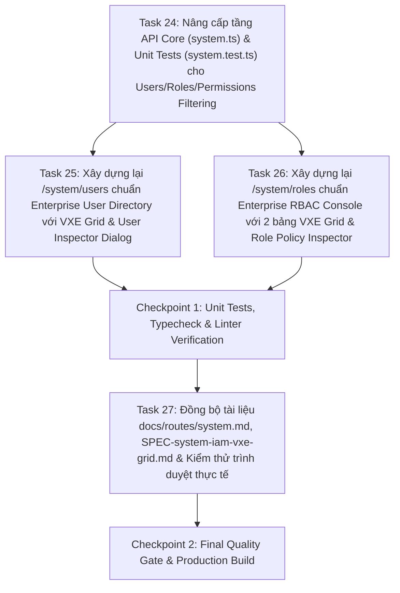

# Implementation Plan: Chuẩn Hóa Giao Diện Quản Trị Người Dùng & Vai Trò Hệ Thống Với VXE Grid (`system-iam-vxe-grid`)

## Overview

Thực thi bản đặc tả đã phê duyệt [`SPEC-system-iam-vxe-grid.md`](../apps/web-admin/docs/specs/SPEC-system-iam-vxe-grid.md) theo chuẩn **Enterprise Cloud Console IAM** (AWS IAM, GitHub Enterprise, Vercel, Supabase). Kế hoạch nâng cấp toàn diện hai màn hình quản trị định danh cấp cao `/system/users` và `/system/roles` trên `@tuquet/admin-web` sang kiến trúc bảng dữ liệu `useVbenVxeGrid` (`vxe-table`) với khả năng tìm kiếm đa trường tức thì, lọc chéo đa chiều (`formOptions`), thanh chỉ số tổng quan (`Stats Bar`), sao chép định danh 1 chạm, và hộp thoại **Inspector Dialog** chuyên sâu.

---

## Architecture Decisions

1. **Enterprise RBAC Policy Catalog (`/system/roles` — Immutable System Primitives & Cross-Referenced Matrix):**
   - Áp dụng triết lý _AWS IAM Managed Policies / GitHub Enterprise Base Roles_: 4 vai trò cốt lõi (`owner`, `admin`, `member`, `viewer`) và 36 quyền hạt nhân thuộc 6 core plugins (`core-iam`, `runners`, `automa`, `storage`, `subscriptions`, `webhooks`) là chính sách nền tảng bất biến (`is_system = true`).
   - Thay thế hoàn toàn Card Grid tĩnh bằng 2 bảng `useVbenVxeGrid` (`RolesGrid` & `PermissionsGrid`) chuyển đổi mượt trên cùng trang:
     - **Bảng Vai Trò (`RolesGrid`):** Lọc theo phân loại (`System Role` / `Custom`), lọc theo `Module` quyền hạn, tìm kiếm theo tên/mô tả/mã quyền; hiển thị preview quyền hạn (`+N quyền khác`) và nút **Chi tiết** mở **Role Policy Inspector Dialog** gom nhóm toàn bộ quyền hạn theo từng Module.
     - **Bảng Quyền Hạn (`PermissionsGrid`):** Lọc theo `Module`, lọc theo **Vai trò sở hữu** (`owner`, `admin`, `member`, `viewer`), tìm kiếm theo mã quyền (`id`) hoặc mô tả; hiển thị trực tiếp cột **Vai trò sở hữu** bằng các `RoleBadge` và nút sao chép nhanh mã quyền.
2. **Enterprise User Directory & Cross-Tenant Membership Inspector (`/system/users`):**
   - Mở rộng `getPlatformUsersApi()` và `mapRawPlatformUser()` trong [`src/api/core/system.ts`](../apps/web-admin/src/api/core/system.ts) để đọc danh sách `tenant_members` kèm thông tin `tenants(id,name,slug)` và `member_roles(roles(id,name,display_name))`, đồng thời giữ tương thích 100% với cấu trúc `{ count: N }`.
   - Xây dựng hàm lọc thuần khiết `filterPlatformUsers(users, filters)` khắc phục triệt để lỗi tìm kiếm UUID/Email trước đây: hỗ trợ tìm kiếm đa trường không phân biệt hoa thường trên **Họ tên**, **Email**, **Định danh UUID**, và **Tên/Slug Workspace**, kết hợp lọc theo trạng thái tổ chức (`all`, `has_tenants`, `no_tenants`) và vai trò (`owner`, `admin`, `member`, `viewer`).
   - Bổ sung **User Inspector Dialog** hiển thị hồ sơ định danh đầy đủ, cho phép sao chép nhanh UUID/Email và liệt kê toàn bộ các Workspace mà người dùng đang tham gia kèm `RoleBadge` và nút điều hướng trực tiếp tới `/tenants/:id`.

---

## Dependency Graph

---

## Task List

### Phase 1: Data Layer & Pure Filter Engine (`system.ts` & `system.test.ts`)

- [x] **Task 24:** Mở rộng `PlatformUserItem` (kèm `workspaces` & `primary_role`), bổ sung bộ ba hàm lọc thuần khiết `filterPlatformUsers`, `filterSystemRoles`, `filterSystemPermissions` trong `src/api/core/system.ts` và viết unit tests trong `src/api/core/__tests__/system.test.ts`

### Phase 2: Enterprise VXE Grid Views (`/system/users` & `/system/roles`)

- [x] **Task 25:** Xây dựng lại [`src/views/system/users/index.vue`](../apps/web-admin/src/views/system/users/index.vue) đạt chuẩn Enterprise User Directory (`Stats Bar`, bộ lọc 3 chiều `formOptions`, cột Workspace & Role Badges, Copy UUID 1 chạm, và `User Inspector Dialog`)
- [x] **Task 26:** Xây dựng lại [`src/views/system/roles/index.vue`](../apps/web-admin/src/views/system/roles/index.vue) đạt chuẩn Enterprise RBAC Console với 2 bảng `useVbenVxeGrid` (`RolesGrid` & `PermissionsGrid`), ánh xạ chéo `Permission -> RoleBadge`, và `Role Policy Inspector Dialog`

### Checkpoint 1: Code & Unit Tests Verification

- [x] `pnpm exec vitest run apps/web-admin/src/api/core` pass 100%, `pnpm --filter @tuquet/admin-web run typecheck` đạt 0 lỗi

### Phase 3: Documentation Sync & Visual Verification

- [x] **Task 27:** Cập nhật [`docs/routes/system.md`](../apps/web-admin/docs/routes/system.md), [`SPEC-system-iam-vxe-grid.md`](../apps/web-admin/docs/specs/SPEC-system-iam-vxe-grid.md) và kiểm thử thực tế giao diện Desktop/Mobile trên `http://localhost:5666/system/users` & `http://localhost:5666/system/roles`

### Checkpoint 2: Complete Quality Gate

- [x] `vitest`, `typecheck`, `oxlint`, `oxfmt`, và `pnpm --filter @tuquet/admin-web run build` kết thúc với 0 lỗi

---

## Risks and Mitigations

| Risk | Impact | Mitigation |
| --- | --- | --- |
| Hai bảng `useVbenVxeGrid` trên cùng trang `/system/roles` chuyển tab bị co hẹp chiều rộng cột | Medium | Dùng `v-if` / `v-else` kết hợp `autoLoad: true` và dữ liệu reactive đã nạp sẵn để VXE Grid tính toán lại kích thước cột chính xác khi chuyển tab. |
| Phá vỡ unit test cũ của `mapRawPlatformUser` khi mở rộng truy vấn `tenant_members` | Medium | Thiết kế `mapRawPlatformUser` hỗ trợ song song cả mảng đếm `[{ count: N }]` lẫn mảng chi tiết `tenant_members` có `tenants` và `member_roles`. |

---

## Open Questions

- Không có câu hỏi mở.
